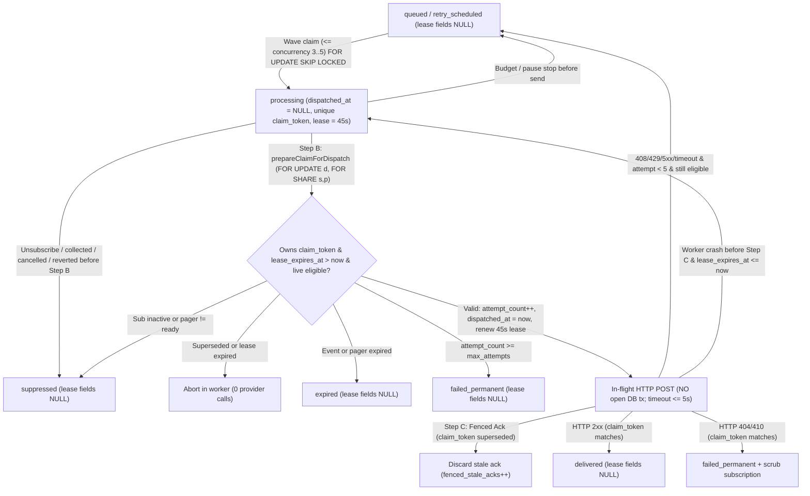

# Pickup Pager Notifications Architecture, Contracts & Incident Runbook

This document is the authoritative specification for Truckly's background pickup-pager notifications, covering the delivery architecture, security/privacy model, ready-state catch-up & deduplication policy, wave-claimed & claim-token-fenced worker state machine, exact runtime configuration table, physical-device verification matrix, and incident recovery procedures.

---

## 1. Selected Delivery Path & Platform Support

### Workspace Inspection
Truckly has **no native Android or iOS app project** (`android/`, `ios/`, Gradle, or Xcode workspaces do not exist; the application is a mobile-first web app in `public/`). Accordingly:
1. **Implemented working path:** Provider-neutral durable PostgreSQL outbox + **standards-compliant Web Push** (`aes128gcm` payload encryption per **RFC 8291 / RFC 8188** and **VAPID ES256** authentication per **RFC 8292**, implemented using Node's built-in `node:crypto` in [`lib/webpush-crypto.js`](../lib/webpush-crypto.js) with zero third-party runtime dependencies) paired with [`public/sw.js`](../public/sw.js) and [`public/manifest.json`](../public/manifest.json).
2. **Documented native adapter contract:** `pager_notification_subscriptions.channel` supports `'web_push' | 'apns' | 'fcm'`. Until a packaged native app and APNs/FCM credentials exist, `'apns'` and `'fcm'` return HTTP `501` (`code: "NATIVE_PUSH_NOT_CONFIGURED"`).
3. **Sample pager isolation:** `pagerDemo === true` in [`public/pager.js`](../public/pager.js) renders **no** push opt-in UI and makes **zero** `/api/pager/*` or subscription requests.

### Browser & OS Requirements (Official Platform Rules)
- **Android (Chrome, Edge, Firefox) & Desktop (Chrome, Edge, Firefox, Safari 16+ on macOS):** Supports Web Push directly from HTTPS tabs after an explicit user gesture (`🔔 Notify me when ready`).
- **iPhone / iPad (iOS & iPadOS 16.4+ Safari / WebKit):**
  - WebKit requires the site to be installed to the user's **Home Screen** (`Share → Add to Home Screen`) and launched in standalone mode via [`public/manifest.json`](../public/manifest.json) (`"display": "standalone"`).
  - Permission (`Notification.requestPermission()`) **must** be triggered from a direct user tap (`#pagerSubscribeBtn`).
  - Every delivered Web Push **must** display a visible notification via `registration.showNotification()` within 30 seconds (enforced unconditionally by [`public/sw.js`](../public/sw.js)).
  - Regular non-installed iOS Safari tabs detect `isIosNeedsHomeScreen()` in [`public/pager.js`](../public/pager.js) and display step-by-step `"Add to Home Screen"` instructions while keeping foreground ~8-second live polling active — never promising background alerts when unavailable.

---

## 2. Security, Privacy & Capability Model

1. **Capability-Authorized Subscriptions (`POST /api/pager/subscriptions`):**
   - Requires possession of an active, non-expired, non-terminal private pager capability (`code` matching `pickup_pagers.id`, whose default lifetime is **24 hours** per `migrations/008_pickup_pagers.sql`).
   - Locks `pickup_pagers` with `FOR NO KEY UPDATE` to serialize concurrent device registrations and concurrent `POST /api/pager/update` transitions on that ticket.
   - Enforces at most `5` active devices per pager (`MAX_ACTIVE_SUBSCRIPTIONS_PER_PAGER = 5`).
   - Returns `{ subscription: { id, channel, status, expires_at }, unsubscribe_token, pager_status, catchup: { queued, reason } }` — **never** returning `endpoint_url`, `p256dh_key`, `auth_secret`, or other subscribers' records.
2. **Unsubscribe & Shared-Device Privacy (`DELETE /api/pager/subscriptions`):**
   - Authorized by `(subscription_id, unsubscribe_token)` or `(subscription_id, code)`.
   - Marks `status = 'unsubscribed'`, **immediately scrubs** `endpoint_url`, `p256dh_key`, `auth_secret`, and `device_token` to `NULL` (enforced by PostgreSQL constraint `pager_sub_material_scrubbed_chk`), and suppresses any `queued`, `retry_scheduled`, or claimed-but-not-yet-dispatched (`status = 'processing' AND dispatched_at IS NULL`) deliveries.
3. **Zero Bearer-UUID Exposure in Push Payloads, URLs, or Logs:**
   - Outbox and encrypted push payloads contain only `{ version, event_type, title, body, vendor, ticket, collapse_key, event_id, subscription_id, open_url: "/#pager-ref=<subscription_id>" }`.
   - The raw private pager bearer UUID (`pickup_pagers.id`) **never** appears in `pager_notification_events.payload`, Web Push ciphertext, notification click URLs, `audit_logs`, `/api/pager/telemetry`, or [`scripts/dev-workbench/debug-admin.js`](../scripts/dev-workbench/debug-admin.js).
   - When a customer opens `/#pager=<uuid>` or `/#pager-ref=<subscription_id>`, [`public/pager.js`](../public/pager.js) immediately scrubs `location.hash` from the browser address bar via `history.replaceState`.
4. **CSRF, SSRF & Rate-Limit Protections:**
   - **CSRF:** Browser `POST`/`DELETE` mutations require `X-BiteShark-Client: web-pager-v1` (or legacy alias `X-Truckly-Client: web-pager-v1`) and pass `Sec-Fetch-Site` + `Origin`/`Host` same-origin checks (`403` otherwise).
   - **SSRF:** Only `https:` port `443` URLs on allowlisted push domains (`fcm.googleapis.com`, `*.push.services.mozilla.com`, `*.push.apple.com`, `*.notify.windows.com`, plus optional server env `TRUCKLY_PUSH_ALLOWED_HOSTS`) with validated on-curve P-256 `p256dh` (65 bytes) and `auth` (16 bytes) keys are accepted. IP literals, credentials, fragments, and path traversals are rejected (`400`).
   - **Rate Limits (`pager_rate_limits`):** Stateless PostgreSQL fixed-window buckets rate-limit:
     - `GET /api/pager/status`: **`90` requests / `60s`** per hashed client IP (`pager_status_client`).
     - `POST /api/pager/subscriptions`: **`12` requests / `300s`** per hashed client IP (`pager_sub_client`) **and** **`10` requests / `300s`** per hashed pager ID (`pager_sub_ticket`), returning `429` + `Retry-After`.
5. **Database Defense-in-Depth (`migrations/015` & `016`):**
   - None of the notification tables are exposed in `hatchable.toml`.
   - All four tables (`pager_notification_subscriptions`, `pager_notification_events`, `pager_notification_deliveries`, `pager_rate_limits`) enforce `FORCE ROW LEVEL SECURITY` requiring transaction-local `app.pager_internal = 'true'`.
   - `pager_delivery_lease_consistency_chk` (`migrations/016_pager_worker_fencing_and_catchup.sql`) enforces at the SQL engine level that `status = 'processing'` rows always carry non-null `(lease_owner, claim_token, lease_expires_at)` and all other statuses clear them to `NULL`.
   - [`public/sw.js`](../public/sw.js) registers **zero `fetch` caching listeners**, guaranteeing private API responses are never cached in Service Worker storage.

---

## 3. Ready-State Catch-Up & Deduplication Policy

1. **Atomic Catch-Up on Active Ready Tickets (`enqueueReadyCatchupInTx`):**
   - When `POST /api/pager/subscriptions` locks an active, non-expired `pickup_pagers` row (`FOR NO KEY UPDATE`) whose `status` is already `'ready'`, it ensures the current ready cycle's canonical `pager_notification_events` row (`dedupe_key = pager:<hash>:ready:<seq>`, `seq = GREATEST(1, ready_notify_count)`) exists and inserts a `pager_notification_deliveries` row (`delivery_origin = 'catchup'`) inside the **same database transaction** as the subscription upsert. If any statement fails, neither subscription nor catch-up commits.
2. **Concurrent Ready Transition vs Subscription Serialization:**
   - `POST /api/pager/update` locks `pickup_pagers` `FOR UPDATE`; `POST /api/pager/subscriptions` locks `pickup_pagers` `FOR NO KEY UPDATE`. PostgreSQL serializes both operations on that ticket:
     - If subscription commits first (while `'cooking'`), no catch-up row is created, and `POST /api/pager/update` immediately creates the `'transition'` delivery for that active subscription.
     - If `POST /api/pager/update` commits first (`status = 'ready'`, `ready_notify_count = seq`), `POST /api/pager/subscriptions` observes the committed `'ready'` tuple and enqueues the `'catchup'` delivery attached to that exact `event_id`.
   - In both orders, **exact 1 event** and **exact 1 delivery** `(event_id, subscription_id)` (`UNIQUE (event_id, subscription_id)`) are produced.
3. **Anti-Storm Deduplication, Reactivation & Token Rotation Rules:**
   - **Repeated registration / refresh (`priorStatus = 'active'`):** Existing `(event_id, subscription_id)` is untouched (`catchup: { queued: false, reason: 'already_enqueued_for_cycle' | 'already_delivered_for_cycle' }`).
   - **Reactivation after unsubscribe/invalidation (`priorStatus IN ('unsubscribed', 'invalidated')`):**
     - If `delivered_at IS NOT NULL` (alert was already delivered during this ready cycle): **never** re-queued (`reason: 'already_delivered_for_cycle'`).
     - If `status = 'suppressed'` and `delivered_at IS NULL` and `attempt_count < max_attempts` (alert was never delivered before the user unsubscribed): re-queued once (`reason: 'reactivated_undelivered'`).
   - **Token / endpoint rotation (`replaces_subscription_id`):** Scrubs the prior subscription on the same pager (`status = 'unsubscribed'`, `invalidated_reason = 'token_rotated'`) and suppresses its un-dispatched deliveries; if the replaced subscription already received the current ready event (`delivered_at IS NOT NULL`), duplicate catch-up is suppressed (`reason: 'already_delivered_prior_token'`).
   - **Per-event catch-up ceiling:** At most `5` catch-up deliveries (`MAX_CATCHUP_DELIVERIES_PER_EVENT = 5`) may be created for any single `event_id`, preventing `DELETE` + new-endpoint registration loops from producing notification storms.
   - **Terminal / expired tickets:** `collected`, `cancelled`, and expired (`expires_at <= now()`) tickets return `404` and cannot create subscriptions or catch-up rows.

---

## 4. Worker Claim, Pre-Dispatch Refresh, Execution Bounds & Fencing

### Delivery State Machine

### Measured Bounds & Concurrency Guarantees
- **Wave claiming within serverless budget:** Instead of claiming 15–25 items upfront and processing sequentially, `runNotificationWorkerBatch` claims waves of at most `concurrency` (`default 3`, `max 5`) up to `batch_size` (`default 15`, `max 25`), stopping cleanly before claiming a new wave whenever `elapsed + providerTimeoutMs + 1000ms > execution_budget_ms` (`default 20,000ms`, `max 25,000ms`). Each outbound HTTP push enforces `DEFAULT_PROVIDER_TIMEOUT_MS = 5,000ms` (`max 8,000ms`), well inside `WORKER_LEASE_SECONDS = 45s`.
- **Pre-dispatch live refresh (`prepareClaimForDispatch`):** Immediately before every outbound `fetch()`, a short transaction locks `d FOR UPDATE` and `s, p FOR SHARE` (ignoring any in-memory fields) to verify:
  1. `d.status = 'processing'`, `d.lease_owner = workerId`, and `d.claim_token = claimToken`.
  2. `d.lease_expires_at > now` (a worker **never** initiates network delivery on an expired or superseded lease).
  3. Live `s.status = 'active'`, `s.expires_at > now`, non-null channel keys, `p.status = 'ready'`, `p.expires_at > now`, and `e.expires_at > now`.
  - Work invalidated between claim and `prepareClaimForDispatch` transitions directly to `'suppressed'` or `'expired'` with **zero provider calls**.
- **No open DB transaction during network I/O:** `prepareClaimForDispatch` commits before `fetch()` begins; `acknowledgeClaimedDelivery` opens a separate short transaction after `fetch()` finishes.
- **Claim-token fencing (`acknowledgeClaimedDelivery`):** Every post-send state change (including `404`/`410` subscription scrubbing) requires `status = 'processing' AND lease_owner = $workerId AND claim_token = $claimToken`. If a hung network call returns after its lease expired and another worker reclaimed the row with a new `claim_token`, the stale worker's acknowledgment is rejected (`fenced_stale_acks++`).
- **Narrow unavoidable at-least-once window:** External HTTP push delivery cannot be atomic with a database commit (`exactly-once` external delivery is impossible). Two narrow windows exist once `fetch()` is already on the wire:
  1. If a customer unsubscribes or staff marks a ticket `collected` *after* `prepareClaimForDispatch` committed and `fetch()` has already transmitted bytes to FCM/APNs/Mozilla, that single in-flight push may still arrive; if `fetch()` fails, `acknowledgeClaimedDelivery` suppresses retries.
  2. If a worker sends `fetch()` and crashes (or stalls past the `45s` lease) *before* `acknowledgeClaimedDelivery` commits, a recovery worker will reclaim and resend (`at-least-once`), using identical Web Push `Topic: pager-ready:<hash>` and Service Worker `tag: collapse_key` (`renotify: false`) to collapse duplicate banners on supporting clients.
- **Retry backoff & retention:** Retryable failures (`408`, `429`, `5xx`, network timeout) schedule `'retry_scheduled'` with `RETRY_BACKOFF_SECONDS = [15, 45, 120, 300, 600]` (`max_attempts = 5` default → retries after `15s`, `45s`, `120s`, `300s`, then `'failed_permanent'` on attempt 5; `600s` applies when `max_attempts > 5`). `purgeExpiredNotificationRecords` scrubs expired active subscriptions immediately, deletes terminal deliveries/events/subscriptions older than **24 hours**, and deletes `pager_rate_limits` windows older than **2 hours**.

---

## 5. Authoritative Runtime Configuration Table (Never Commit Secret Values)

> **Restart / Redeploy Note:** Code reads `process.env.*` dynamically on each request rather than caching values at module initialization. However, on Hatchable and typical serverless platforms, updating environment variables or secrets **requires redeploying or recycling function instances** to update `process.env` unless live hot-reload is explicitly verified on the target runtime (**not yet verified on hosted Hatchable** — do **not** assume zero-redeploy propagation).

| Exact Variable Name | Allowed Values / Format | Default (Unset) | Invalid / Production Fail-Closed Behavior | Scope (Modules Reading It) | Change Propagation |
|---|---|---|---|---|---|
| `TRUCKLY_ENV` | `local` \| `development` \| `test` \| `staging` \| `production` | `""` (unclassified) | Unrecognized value disables push (`mode: 'invalid_config'`); staging probe rejects anything except `'staging'` | `lib/pager-notifications.js`, `scripts/staging-runtime-probe.template.js` | Redeploy / instance recycle |
| `TRUCKLY_PUSH_PROVIDER_MODE` | `disabled` \| `webpush` (`fake` \| `loopback_test` in local/test only) | `disabled` | Unrecognized value, or `fake`/`loopback_test` in production (`TRUCKLY_ENV=production`, `NODE_ENV=production`, or `proj_MEO518rmLLl0`) or without `TRUCKLY_ALLOW_TEST_PUSH_MODES=1`, fails closed (`enabled: false`) | `lib/pager-notifications.js` (`status`, `subscriptions`, `worker`, `telemetry`) | Redeploy / instance recycle |
| `TRUCKLY_ALLOW_TEST_PUSH_MODES` | `1` (local/CI test harness only; **never set in production**) | Unset (`0`) | Ignored in production (`isProductionEnvironment()` hard-blocks `fake`/`loopback_test` even if `'1'`) | `lib/pager-notifications.js` | Test process env only |
| `TRUCKLY_VAPID_PUBLIC_KEY` | 87-char base64url uncompressed P-256 public key (65 bytes) | Unset | Missing/malformed in `webpush` mode disables push (`enabled: false`, `config_valid: false`) | `lib/pager-notifications.js` | Redeploy / instance recycle |
| `TRUCKLY_VAPID_PRIVATE_KEY` | 43-char base64url 32-byte P-256 private scalar (**secret manager only**) | Unset | Missing/mismatched scalar disables push (`enabled: false`, `config_valid: false`) | `lib/pager-notifications.js` | Redeploy / instance recycle |
| `TRUCKLY_VAPID_SUBJECT` | `mailto:<email>` or `https://<host>...` | Unset | Missing/malformed URI disables push (`enabled: false`, `config_valid: false`) | `lib/pager-notifications.js` | Redeploy / instance recycle |
| `TRUCKLY_NOTIFICATION_WORKER_SECRET` | Random `>= 24`-char secret (**secret manager only**); sent via `Authorization: Bearer <secret>` or `X-Worker-Secret: <secret>` | Unset | `< 24` chars returns `503 WORKER_NOT_CONFIGURED`; mismatch returns `401` | `api/pager/worker.js`, `api/pager/telemetry.js`, `scripts/run-pager-worker.cjs` | Redeploy + scheduler secret update |
| `TRUCKLY_DISABLE_SUBSCRIPTIONS` | `0` \| `false` \| `1` \| `true` | `0` (not paused) | Any other non-empty string fails closed (`true` = pauses `POST /api/pager/subscriptions` with `503` while keeping `GET`/`DELETE` active) | `lib/pager-notifications.js` (`status`, `subscriptions`, `telemetry`) | Redeploy / instance recycle |
| `TRUCKLY_DISABLE_NOTIFICATION_DELIVERY` | `0` \| `false` \| `1` \| `true` | `0` (not paused) | Any other non-empty string fails closed (`true` = worker pauses dispatch while retaining outbox rows) | `lib/pager-notifications.js` (`worker`, `telemetry`) | Redeploy / instance recycle |
| `TRUCKLY_PAUSE_WRITES` | Comma-separated: `bookings`, `pagers`, `community`, `owner`, `notifications`, `all` | Unset (no scopes paused) | Any unrecognized scope token fails closed (pauses **all** hardened write scopes with `503` while preserving public reads & RLS) | `lib/authz.js`, `lib/pager-notifications.js`, write handlers in `api/**` | Redeploy / instance recycle |
| `TRUCKLY_PUSH_ALLOWED_HOSTS` | Optional comma-separated extra HTTPS push hostnames | Unset (built-in allowlist only) | IP literals, `localhost`, `.local`, `.internal`, HTTP, and non-443 ports remain blocked | `lib/pager-notifications.js` | Redeploy / instance recycle |
| `TRUCKLY_ENABLE_NATIVE_PUSH` | `1` only after packaged mobile APNs/FCM transport is implemented | Unset (`501`) | Unset / non-`'1'` rejects `apns`/`fcm` subscriptions with `501 NATIVE_PUSH_NOT_CONFIGURED` | `lib/pager-notifications.js` | Redeploy / instance recycle |
| `TRUCKLY_PLATFORM_ADMIN_IDS` | Optional comma-separated Hatchable `user.id` values | Unset (uses `platform_roles` table) | Static env-granted admin IDs; DB `platform_roles` preferred for transaction-serialized revocation | `lib/authz.js` | Redeploy / instance recycle |
| `TRUCKLY_RELEASE_SHA` | Git commit SHA reported in `GET /api/pager/telemetry` | Falls back to `GITHUB_SHA` or `"local-dev"` | Read-only observability string | `api/pager/telemetry.js` | Set at deploy time |
| `TRUCKLY_STAGING_PROBE_TOKEN` | Ephemeral `>= 24`-char secret on isolated staging only | Unset (`404`) | `< 24` chars or mismatch returns `404`; **delete probe & secret after staging run** | `scripts/staging-runtime-probe.template.js` | Staging deploy only |

### Worker Scheduler Invocation
Serverless handlers never rely on background `setTimeout` timers after responding. Invoke `POST /api/pager/worker` every `10–15 seconds` from an external scheduler or supervised runner (`node scripts/run-pager-worker.cjs --url https://<host>/api/pager/worker --max-ticks 4 --interval-ms 12000`) passing `Authorization: Bearer <TRUCKLY_NOTIFICATION_WORKER_SECRET>` (or `X-Worker-Secret`). Keep `TRUCKLY_PUSH_PROVIDER_MODE=disabled` until staging and physical-device checks pass.

---

## 6. Physical-Device Verification Matrix (Required Before Production Enablement)

Loopback RFC 8291/8292 encryption/decryption tests and headless Chromium E2E (`tests/pager-notifications-browser.e2e.cjs`) **do not** prove interoperability with live Mozilla Autopush, Google FCM, or Apple Web Push endpoints or OS lock-screen delivery. Execute and record the following on designated disposable devices against isolated staging before enabling `TRUCKLY_PUSH_PROVIDER_MODE=webpush` in production:

| Scenario | Target Devices | Pass Criteria |
|---|---|---|
| 1. Installed PWA background push | iPhone (iOS 16.4+, Home Screen PWA) + Android Chrome | Alert arrives within 15s with browser backgrounded. |
| 2. Screen locked privacy & alert | iPhone + Android | Lock screen shows generic ticket/vendor ready message; no bearer UUID exposed. |
| 3. Notification tap routing | iPhone + Android | Tapping notification opens Truckly directly to the ready ticket (`#pager-ref` scrubbed). |
| 4. Ready-state catch-up | Subscribe on device *after* ticket is already marked `ready` | Device receives 1 immediate catch-up push; refreshing page does not re-send. |
| 5. Subscription invalidation (`410`) | Revoke site notification permission -> trigger ready | Worker records `invalidated_subscriptions: 1` and scrubs DB endpoint/keys to `NULL`. |
| 6. Duplicate collapse | Replay worker after simulated mid-flight retry | `Topic` + SW `tag` collapse prevents duplicate audible banners. |

---

## 7. Incident Response, Pause & Safe Recovery Runbook

1. **Pause outbound push dispatch (provider storm / misconfiguration):**
   - Set `TRUCKLY_DISABLE_NOTIFICATION_DELIVERY=1` and redeploy/recycle functions (or stop the external worker scheduler for immediate halt without waiting on function recycle). P0 RBAC, bookings, community RLS, and foreground 8s pager polling remain 100% operational.
2. **Pause new push subscriptions (endpoint flood / abuse):**
   - Set `TRUCKLY_DISABLE_SUBSCRIPTIONS=1` and redeploy/recycle functions (`POST /api/pager/subscriptions` returns `503 SUBSCRIPTIONS_PAUSED`; `GET` status and `DELETE` unsubscribe remain active).
3. **Inspect queue & configuration health (Platform Admin):**
   - Call `GET /api/pager/telemetry` as `platform_admin` to inspect `controls.config_valid`, `controls.config_errors`, `deliveries.queued`, `deliveries.claimed_pending_dispatch`, `deliveries.in_flight_dispatched`, `deliveries.expired_leases`, `deliveries.retry_scheduled`, `deliveries.failed_permanent`, and `recent_redacted_errors`.
4. **Recover or drain backlog safely:**
   - Any crashed worker lease (`status = 'processing'`) automatically becomes eligible for recovery after `45s` (`WORKER_LEASE_SECONDS`).
   - Tickets past `pickup_pagers.expires_at` (`24 hours` from creation) or marked `collected`/`cancelled` are automatically expired/suppressed during `prepareClaimForDispatch` and `purgeExpiredNotificationRecords` without calling push providers.
