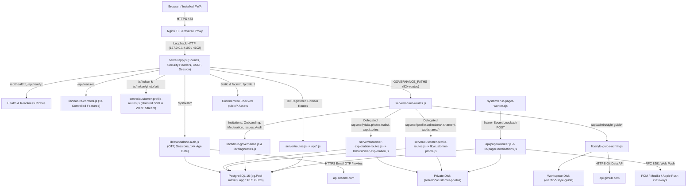
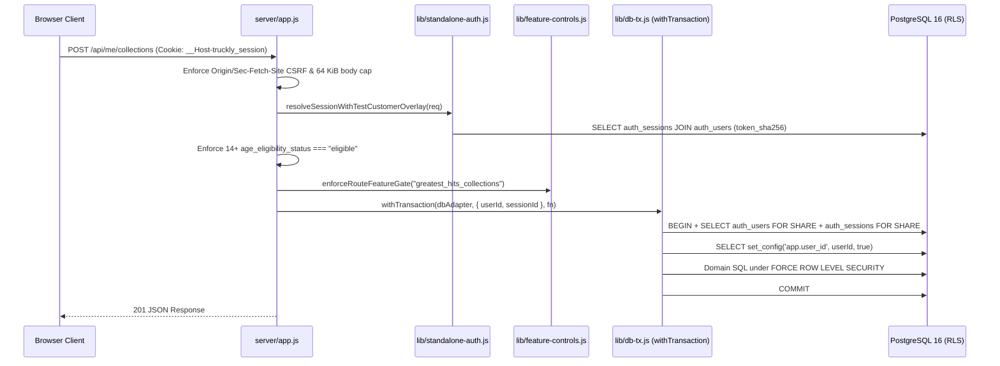

# 02 — Repository Architecture & Subsystem Map

- **Repository**: `https://github.com/yamanalmasaleha-png/trukly-.git`
- **Audited Branch / Commit**: `working/biteshark-vps` @ `f0e5e5deedc7636f448e1b0d629ceb1787d79944`
- **Tracked Inventory**: `361` files total · `232` first-party non-doc/non-vendor code files (`125,575` LOC) · `29` SQL migrations · `58` application tables (`59` counting `schema_migrations`).

---

## 1. Technology Stack & Runtime Topology

| Layer | Implementation | Key Characteristics |
|---|---|---|
| **HTTP & Application Runtime** | Node.js 22 (`"type": "module"` ESM + `.cjs` ops/test scripts), native `node:http` (`server/index.js`, `server/app.js`) | Zero web framework (`Express`/`Fastify` absent); loopback-only binding (`127.0.0.1:4100` primary staging, `127.0.0.1:4102` secondary `staging2`). |
| **Reverse Proxy & TLS** | Nginx (`deploy/nginx/*.conf.template`) | Terminates HTTPS, sets `X-Forwarded-Proto`, enforces `64k` default body cap (`1m` `/api/onboarding/evidence`, `8m` `/api/me/photos`), blocks dotfiles and `/debug-admin.*`. |
| **Database** | PostgreSQL 16 (`pg@8.23.1`, `packages/runtime-adapter/index.js`, `lib/db-tx.js`) | Separate `migrator` DDL owner role vs `NOBYPASSRLS` runtime `app` role; bounded `pg.Pool` (`DB_POOL_MAX = 8`); 44 tables with `FORCE ROW LEVEL SECURITY` keyed on transaction-local `app.*` GUCs (`set_config(..., true)`). |
| **Authentication & Sessions** | First-party passwordless Email OTP (`lib/standalone-auth.js`, `cookie@1.1.1`) | 6-digit HMAC-SHA-256 OTPs via Resend HTTPS API (or secret-gated staging mailbox), `__Host-truckly_session` cookie (SHA-256 token hash in `auth_sessions`), 14+ age-eligibility enforcement (`lib/age-policy.js`), and `__Host-bs_admin_test_session` admin sandbox overlay (`lib/admin-test-customer.js`). |
| **Media & File Storage** | `sharp@0.35.5` (`lib/photo-storage.js`) + JSON state (`lib/style-guide-admin.js`) | Magic-byte check + full `sharp` decode (`<= 25 MP`, `cache(false)`, `concurrency(1)`), EXIF/GPS strip, `0600` atomic `fsync`+`rename` under `/var/lib/*/customer-photos`, and `/var/lib/*/style-guide/workspace-state.json`. |
| **Background Worker & Push** | `scripts/run-pager-worker.cjs` -> `POST /api/pager/worker` (`lib/pager-notifications.js`, `lib/webpush-crypto.js`) | Systemd daemon polling every `10s`; PostgreSQL `FOR UPDATE SKIP LOCKED` lease + monotonic `fence_token`, RFC 8291 `aes128gcm` encryption + ES256 VAPID JWTs, photo storage reconciliation (`lib/photo-storage.js`). |
| **Frontend Architecture** | Vanilla multi-script SPA (`public/index.html` + 18 `<script>` files) + `/admin` (`public/admin.html`) + `/login.html` + SSR `/s/:token` | No bundler or frontend framework; Service Worker (`public/sw.js`) handles Web Push notifications only with zero `fetch` caching interceptors. |
| **Engineering Governance** | `tools/code-registry/` (vendored `acorn` AST + SQL + HTML/CSS scanner) & `tools/style-guide/` | Generates `docs/engineering/generated/*`, validates `drift-baseline.json` and `SCHEMA-INVENTORY.md` against live `pg_catalog`, and renders 18 Style Guide docs from `decisions.json`. |

---

## 2. Directory & Ownership Inventory

| Path | Tracked Files | First-Party Code LOC | Role & Ownership Classification |
|---|---:|---:|---|
| `server/` | `6` | `10,948` | Core HTTP server (`index.js`, `app.js`), explicit 30-route domain manifest (`routes.js`), 8,331-line governance router (`admin-routes.js`), exploration (`customer-exploration-routes.js`), and profile/sharing (`customer-profile-routes.js`). |
| `api/` | `30` | `2,592` | Legacy-shaped domain handlers (`trucks/*`, `favorites/*`, `bookings/*`, `owner/*`, `vendor/*`, `pager/*`, `community/*`, `notifications/*`) invoked in-process via `server/routes.js`. |
| `lib/` | `25` | `22,491` | Core domain services: `customer-profile.js` (`4,475`), `standalone-auth.js` (`3,383`), `customer-exploration.js` (`2,765`), `feature-controls.js` (`2,024`), `pager-notifications.js` (`1,871`), `style-guide-admin.js` (`1,720`), `diagnostics.js` (`1,045`), `photo-storage.js`, `authz.js`, `db-tx.js`, `discovery.js`, `catalog.js`. |
| `packages/runtime-adapter/` | `2` | `155` | Local workspace package (`@biteshark/runtime-adapter`) adapting Node HTTP requests and `pg.Pool` into `(req, ctx)` handler signatures. |
| `public/` | `61` | `32,140` | Static HTML, CSS, SVG illustrations, and browser JS (`admin.js` `5,274`, `role-experience.js` `3,962`, `app.js` `3,773`, `admin-style-guide.js` `2,968`, `customer-profile.js`, `greatest-hits*.js`, `pager.js`, `sw.js`, `policies/*.html`). Includes stale `public/build.json`. |
| `migrations/` | `29` | `4,468` | Immutable, checksum-verified additive SQL migrations `001`–`029`. |
| `deploy/` | `17` | `2,184` | Release installer (`install-staging-release.sh`), Nginx templates, systemd service/timer units, GPG backup script (`truckly-staging-backup.sh`), staging2 controller (`biteshark-staging2-ctl`), holding page. |
| `scripts/` | `14` | `2,812` | Operational CLIs (`run-migrations.cjs`, `bootstrap-top-admin.cjs`, `manage-feature-controls.cjs`, `reconcile-photo-storage.cjs`, `run-pager-worker.cjs`, `build-linux-release-tarball.cjs`) + legacy `dev-server.cjs`. |
| `tools/` | `17` | `7,410` | `tools/code-registry/*` (`scanner.mjs`, `js-analyzer.mjs`, `backend-db-analyzer.mjs`, `drift-detector.mjs`, plus vendored `tools/code-registry/vendor/acorn/*` excluded from first-party defect scanning) and `tools/style-guide/*`. |
| `tests/` | `41` | `39,814` | Unit, static contract, PostgreSQL 16 integration, and headless Chromium CDP/Playwright E2E test suites. |
| `docs/` | `108` | — | Engineering handbook (`docs/engineering/`), generated inventories, unfinished Style Guide (`docs/engineering/style-guide/`), VPS runbooks, and `docs/archive/hatchable/`. |
| `.github/` & Root | `11` | `561` | CI workflow (`.github/workflows/truckly-source-review.yml`), `package.json`, `AGENTS.md`, `README.md`, `TECH_MAP.md`, plus legacy archives `truckly-v63.zip` and `truckly-data.sql.gz`. |

---

## 3. System Component & Request Routing Architecture

---

## 4. Critical Data & Security Flows

### 4.1 Request Authentication, Age Policy, CSRF & Transaction Locking

### 4.2 Unlisted Collection Sharing & Scoped Moderation Isolation

1. **Creation**: Authenticated 14+ customer completes zero-DOB-storage 18+ self-attestation (`POST /api/me/sharing-eligibility` -> `customer_sharing_eligibility`) and creates an unlisted share link (`POST /api/me/shares/create`), generating a 256-bit `base64url` token whose raw value is returned once and stored only as `token_sha256` + `bs_…<last4>` in `customer_collection_shares`.
2. **Consented Photo Derivatives**: Attaching a private `pht_*` photo (`POST /api/me/collections/attach-photo`) decodes and re-encodes a dedicated EXIF-stripped WebP derivative (`sha_*_shared.webp`) so revoking a share or attachment never touches private `customer_photos`, while deleting the source `pht_*` photo cascades revocation to all derived `sha_*` attachments.
3. **Moderator Boundary**: When a recipient reports a link (`POST /api/shared/report` by `shr_*` ID, never raw token), `enableShareModerationGuardsInTx` sets `app.share_moderation = 'true'` while keeping `app.user_id` bound to the moderator's own user ID—so PostgreSQL `FORCE ROW LEVEL SECURITY` permits inspecting shared collection rows while physically blocking moderator SQL access to private `customer_visits` notes and unshared `customer_photos`.

---

## 5. Significant Structural & Design Concerns

1. **Monolithic Governance Router (`server/admin-routes.js`, `8,331` lines — [AUD-0036](03_COMPLETE_FINDINGS.md#aud-0036))**: `handleGovernanceApiRequest` spans `7,728` lines of imperative `if (normPath === ...)` checks and delegates customer exploration/profile traffic *after* running `loadAccessContext` (`2` wasted DB queries per customer request — [AUD-0033](03_COMPLETE_FINDINGS.md#aud-0033)). Lack of declarative per-route metadata caused repeated omissions in `isPreviewViewpoint` (`33/34` mutating routes missed — [AUD-0014](03_COMPLETE_FINDINGS.md#aud-0014)), `BITESHARK_PAUSE_WRITES`, and SQL `ILIKE` escaping ([AUD-0008](03_COMPLETE_FINDINGS.md#aud-0008)).
2. **Dual API Envelope Conventions**: Legacy `api/*.js` handlers return bare arrays/objects (`200 [...]` or `{ error }`), whereas `server/admin-routes.js`, `customer-exploration-routes.js`, and `customer-profile-routes.js` return `{ ok: true, ... }` / `{ ok: false, error, code, correlation_id }`. Documented in `docs/engineering/API-CONTRACTS.md`, this split requires preserve-in-place care so existing clients do not break.
3. **Load-Order Browser Global Chaining (`public/index.html` — [AUD-0036](03_COMPLETE_FINDINGS.md#aud-0036))**: Eighteen classic `<script>` tags share the global `window` namespace, with 12 baseline global redefinitions (`openDetail` wrapped 3 times across `app.js`, `guide-passport.js`, and `listing-highlights.js`; `applyFilters` wrapped twice) and an unpinned synchronous `<script src="https://unpkg.com/...">` tag ([AUD-0010](03_COMPLETE_FINDINGS.md#aud-0010)) blocking all 18 local scripts.
4. **Partial Migration to `FORCE ROW LEVEL SECURITY` ([AUD-0012](03_COMPLETE_FINDINGS.md#aud-0012))**: Migrations `019`–`029` consistently apply `FORCE ROW LEVEL SECURITY`, but 14 earlier tables (`migrations/001`–`011`, `018` — including `favorites`, `bookings`, `notification_settings`, `pickup_pagers`, `platform_roles`, and `audit_logs`) remain non-RLS, even where `api/favorites/toggle.js` and `api/notifications/settings.js` set `app.user_id` GUCs expecting RLS.
5. **Tight 8-Connection Pool & 961 MiB Co-Tenant VPS Headroom ([AUD-0033](03_COMPLETE_FINDINGS.md#aud-0033), [AUD-0044](03_COMPLETE_FINDINGS.md#aud-0044))**: Parallel `Promise.all` transaction checkouts (`4` connections per `/api/me/profile` request) and synchronous 18-file Style Guide Markdown renders ([AUD-0031](03_COMPLETE_FINDINGS.md#aud-0031)) create avoidable contention on the single-vCPU / 961 MiB staging host.
