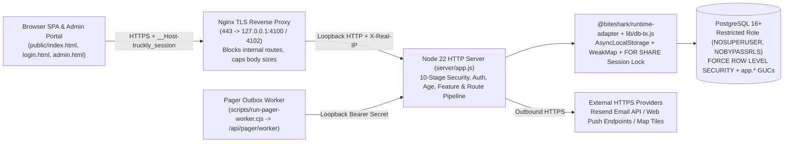

# BiteShark System Architecture

BiteShark is a **zero-build browser frontend** (`public/*.html`, `public/*.js`, `public/*.css`) served alongside a **standalone Node.js 22 HTTP & PostgreSQL 16+ server** (`server/index.js` -> `server/app.js`) behind TLS-terminating Nginx on a single-vCPU / 961 MiB Linux VPS (`172.233.140.74`).

For operational runbooks, see [STANDALONE_VPS_RUNTIME_AND_AUTH.md](../STANDALONE_VPS_RUNTIME_AND_AUTH.md) and [VPS_OPERATIONS.md](../VPS_OPERATIONS.md).

---

## 1. End-to-End Request & Data Topology

---

## 2. Core Architectural Invariants

1. **Loopback-Only Application Binding**:
   - `server/index.js` binds to `127.0.0.1:4100` (`4102` on `staging2`). External traffic enters exclusively through Nginx, which strips spoofed forwarding headers, blocks `/api/pager/worker` (`403`), and hides `/api/auth/staging-mailbox`, `/api/_staging_gate_probe`, `/__debug`, and `/debug-admin.*` (`404`).
2. **Unforgeable Request Identity (`@biteshark/runtime-adapter`)**:
   - `server/app.js` strips `x-truckly-debug-role` / `x-biteshark-debug-role` on every request, resolves `__Host-truckly_session` against `auth_sessions` + `auth_users`, and binds the frozen `{ id, email }` identity via `WeakMap` (`bindVerifiedRequestUser`) and `AsyncLocalStorage` (`runWithRequestContext`). Client headers, query strings, and request bodies can never supply identity.
3. **Database Least Privilege + Row-Locked Transactional Eligibility**:
   - In `staging` and `production`, `server/index.js` queries `pg_roles` at startup and refuses to boot if the DB pool user has `rolsuper` or `rolbypassrls`.
   - Protected routes execute inside `withTransaction(db, fn)` ([db-tx.js](../../lib/db-tx.js)), which acquires deterministic `FOR SHARE` locks (`auth_users` -> `auth_sessions`) before running handler SQL so concurrent suspensions, session revocations, or under-14 blocks abort in-flight mutations immediately (`SessionEligibilityError`).
4. **Authoritative Control Hierarchy**:
   - Environment emergency/provider variables (`BITESHARK_PAUSE_WRITES`, `BITESHARK_PUSH_PROVIDER_MODE`, `BITESHARK_DISABLE_SUBSCRIPTIONS`, `BITESHARK_DISABLE_NOTIFICATION_DELIVERY`) **always** outrank database `feature_controls` rows (`lib/feature-controls.js`).
5. **Conservative Memory & Pool Footprint**:
   - Designed for a shared 961 MiB VPS: `BITESHARK_DB_POOL_MAX` defaults to `8` (`6` in staging, `4` on `staging2`), Node runs with `--max-old-space-size=128` (`96` on `staging2`/worker), HTTP timeouts are bounded (`headersTimeout=15s`, `requestTimeout=30s`, `keepAliveTimeout=5s`), and diagnostics cap stored groups (`500`) and samples per group (`15`).
