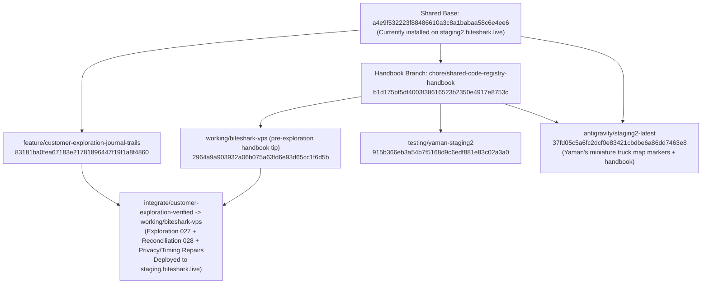

# Branch Topology & Environment Isolation Map

This document separates **1. Stable Environment Isolation Policy** from **2. Dated Git & Release Snapshot Metadata** (`Snapshot Date: 2026-11-22`).

> [!CAUTION]
> **Live Host Truth vs Git Branch Names**:
> - Git branch names never prove what commit is currently running on a VPS host.
> - Live deployed SHA truth comes strictly from `/api/healthz` (`release_sha`) and `/srv/*/current` symlink targets on `172.233.140.74`. Never update live deployment claims in documentation from Git branch names alone.

---

## 1. Dated Git Branch Snapshot (`Recorded 2026-11-22`)

- **Remote URL**: `https://github.com/yamanalmasaleha-png/trukly-/` (`origin`)
- **Authoritative Development & Integration Branch**: `working/biteshark-vps` (`586be39b42bd90501daba2f4afcbd4d7597a2b7e` as of `2026-11-22`; established in [README.md](../../README.md#L5) and [VPS_OPERATIONS.md](../VPS_OPERATIONS.md))
- **Pre-Exploration Shared Merge-Base**: [`a4e9f532223f88486610a3c8a1babaa58c6e4ee6`](https://github.com/yamanalmasaleha-png/trukly-/commit/a4e9f532223f88486610a3c8a1babaa58c6e4ee6)
- **Handbook Integration Baseline on `working/biteshark-vps`**: [`2964a9a903932a06b075a63fd6e93d65cc1f6d5b`](https://github.com/yamanalmasaleha-png/trukly-/commit/2964a9a903932a06b075a63fd6e93d65cc1f6d5b)
- **Integrated Customer-Exploration Candidate**: [`83181ba0fea67183e21781896447f19f1a8f4860`](https://github.com/yamanalmasaleha-png/trukly-/commit/83181ba0fea67183e21781896447f19f1a8f4860) (`feature/customer-exploration-journal-trails`), merged and hardened via `integrate/customer-exploration-verified` (`migrations/001`–`028`) into `working/biteshark-vps`.

---

## 2. Active Branches & Remaining Differences With `staging2`

| Branch Name (`origin/*`) | Relationship & Schema Sequence | Scope Summary | Environment Relationship |
|---|---|---|---|
| `working/biteshark-vps` | Authoritative primary branch (`migrations/001`–`028`, `97` HTTP routes, `21` feature controls, `sharp@0.35.5`). | Unified VPS runtime + Shared Engineering Handbook + verified account-backed Local Guides, Stories, Visit Journal, EXIF-stripped private photos + reconciliation (`028`), badges, challenges, Suggested Trails & `#rxExplorationPrivacyModal`. | Deployed to **`https://staging.biteshark.live`** (`/srv/truckly-staging/current`). |
| `integrate/customer-exploration-verified` | Verification & repair branch merged into `working/biteshark-vps`. | Identifiable merge of `83181ba0fea6` onto `2964a9a90393` + post-save trail timing fix, hidden-mode privacy export/download/delete, `028` photo reconciliation, policy parity & updated handbook/registry. | Staging integration & CI verification branch. |
| `feature/customer-exploration-journal-trails` | `83181ba0fea67183e21781896447f19f1a8f4860` (ancestor of `working/biteshark-vps`). | Original exploration implementation commit (`001`–`027`). Preserved untouched on `origin` and retained under `/srv/truckly-staging/releases/83181ba...` as the immediate pre-deployment rollback release. | Superseded on `staging.biteshark.live` by `working/biteshark-vps`. |
| `testing/yaman-staging2` | `915b366eb3a54b7f5168d9c6edf881e83c02a3a0` (`001`–`026`, `85` HTTP routes, `14` feature controls). | Baseline `a4e9f53` + Shared Engineering Handbook (`b1d175bf`). Does **not** yet include `83181ba`/exploration (`027`–`028`) or Yaman's `a2f0135` map-cards feature. | Provisioned operator branch for `staging2.biteshark.live` (host currently serves `a4e9f53...`). |
| `antigravity/staging2-latest` | `37fd05c5a6fc2dcf0e83421cbdbe6a86dd7463e8` (`001`–`026`, `85` HTTP routes). | Yaman's miniature SVG cuisine truck map markers (`public/map-cards.{js,css}`, `tests/map-cards.test.cjs` from `a2f0135`) + Shared Engineering Handbook (`b1d175bf`). Does **not** yet include exploration (`027`–`028`). | Active secondary-staging development branch for `staging2.biteshark.live` (left untouched by primary-staging deployment). |

### Historical / Retired Branches on `origin` (Do Not Target for Active VPS Work)
- `main` (`614dc997e1b903c94948dc7ff13d02e51c434acd` — earlier Nov 17 VPS verification baseline; behind `working/biteshark-vps`).
- `fix/discovery-cards-compact-ux`, `fix/urgent-pilot-security-hardening` (already ancestor-merged into `a4e9f53`).
- Pre-VPS / Hatchable historical refs (`harden/*`, `improve/*`, `migrate/*`) — retained for audit history only.

---

## 3. Isolated Environment Matrix on `172.233.140.74`

| Property | Primary Staging (`staging.biteshark.live`) | Secondary Staging (`staging2.biteshark.live`) | Apex Domain (`biteshark.live`) |
|---|---|---|---|
| **Purpose** | Primary pre-production verification & integration | Yaman's isolated development/testing sandbox | Static pre-launch holding page ONLY |
| **Loopback Bind** | `127.0.0.1:4100` | `127.0.0.1:4102` | Static Nginx root (`/srv/biteshark/holding/public`) |
| **Release Root** | `/srv/truckly-staging/{releases,current}` | `/srv/biteshark-staging2/{releases,current}` | N/A |
| **Persistent Upload Dir** | `/var/lib/truckly-staging/customer-photos` (`0700 truckly-stg:truckly-stg`) | `/var/lib/biteshark-staging2/customer-photos` *(template prepared; create `0700 biteshark-stg2:biteshark-stg2` before deploying exploration to `staging2`)* | None |
| **Config Dir** | `/etc/truckly-staging/` | `/etc/biteshark-staging2/` | `/etc/nginx/sites-available/z-biteshark.live` |
| **Systemd Units** | `truckly-staging-api.service`, `truckly-staging-worker.service`, `truckly-staging-backup.timer` | `biteshark-staging2-api.service`, `biteshark-staging2-backup.timer` *(no worker unit)* | Nginx only (`/api/*` returns `404`) |
| **Linux Service User** | `truckly-stg` | `biteshark-stg2` (migrate/build: `biteshark-stg2-mig`; operator: `yaman`) | `www-data` |
| **PostgreSQL DB & Roles** | DB `truckly_staging` (`truckly_stg_app` / `truckly_stg_migrator`) | DB `biteshark_staging2` (`biteshark_stg2_app` / `biteshark_stg2_migrator`) | None |
| **Deployment Tool** | `deploy/install-staging-release.sh` (root SSH) | `sudo /usr/local/sbin/biteshark-staging2-ctl deploy` (`deploy/bin/biteshark-staging2-ctl`) | Manual static HTML only |

---

## 4. Remaining Cross-Branch Coordination Guidance (`working/biteshark-vps` vs `antigravity/staging2-latest`)

When `antigravity/staging2-latest` (`37fd05c5`, containing `a2f0135` miniature truck map markers) is ready for integration with `working/biteshark-vps`:
1. **`public/app.js`**: Disjoint edits (`37fd05c5` modifies map listener/marker rendering around `bindMapResizeAndZoomListeners` / `renderMapCards` / `applyFilters`; `working/biteshark-vps` modifies `extraDetail` / `openDetail` exploration CTAs and `syncAuthAndUserData` / `applyConfirmedClientSignOutCleanup`).
2. **`public/index.html`**: Adjacent `<script>` load block near line 420! Keep exact order:
   `diagnostics-client.js` -> `auth-client.js` -> `exploration-client.js` -> `role-experience.js` -> `map-cards.js` -> `app.js` (so `role-experience.js` and `app.js` have `window.bitesharkExploration`, and `app.js` has `window.BiteSharkMapCards`).
3. **Migrations**: `027_customer_exploration_foundation.sql` and `028_exploration_photo_reconciliation.sql` occupy slots `027` and `028` on `working/biteshark-vps`; any new SQL migration on `staging2` must start at **`029_`** or later (`npm run registry:compare -- --base origin/working/biteshark-vps --head HEAD --merge-base`).
