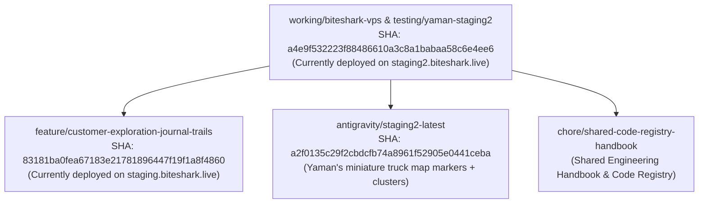

# Branch Topology & Environment Relationship Map

This record documents the **verified Git branch topology and narrow release metadata** inspected on `2026-11-22` before handbook integration.

> [!CAUTION]
> **Deployed SHA != Permanent Branch Mapping**: Installing a commit tarball onto `staging` or `staging2` proves that exact commit SHA is currently running on that host — it does **not** automatically redefine the authoritative integration branch. Always check `git log` and `merge-base` before integrating or deploying.

---

## 1. Repository & Authoritative Base

- **Remote URL**: `https://github.com/yamanalmasaleha-png/trukly-/` (`origin`)
- **Documented Integration Branch**: `working/biteshark-vps` (established in [README.md](../../README.md#L5) and [VPS_OPERATIONS.md](../VPS_OPERATIONS.md))
- **Common Merge-Base SHA Across Active Work**: [`a4e9f532223f88486610a3c8a1babaa58c6e4ee6`](https://github.com/yamanalmasaleha-png/trukly-/commit/a4e9f532223f88486610a3c8a1babaa58c6e4ee6) (*"fix(deploy): grant unprivileged staging2 build user read-only group access to root-copied release archive"*)
- **Dedicated Handbook Implementation Branch**: `chore/shared-code-registry-handbook` (branched cleanly from `a4e9f532223f88486610a3c8a1babaa58c6e4ee6`)

---

## 2. Active Branches & Merge-Base Evidence (Pre-Integration Starting State)

| Branch Name (`origin/*`) | Starting Commit SHA | Merge-Base with `working/biteshark-vps` | Ahead / Behind `a4e9f53` | Author / Scope Summary | Evidence Connecting to Environments |
|---|---|---|---|---|---|
| `working/biteshark-vps` | `a4e9f532223f88486610a3c8a1babaa58c6e4ee6` | `a4e9f532223f88486610a3c8a1babaa58c6e4ee6` | `0 / 0` | Shared VPS integration baseline (migrations `001`–`026`, compact discovery cards, `staging2` ctl fix). | Named as authoritative integration branch in `README.md:5` and `docs/VPS_OPERATIONS.md`. |
| `feature/customer-exploration-journal-trails` | `83181ba0fea67183e21781896447f19f1a8f4860` | `a4e9f532223f88486610a3c8a1babaa58c6e4ee6` | `+1 / 0` | Matt: Account-backed Local Guides, Stories, Visit Journal (`027`), private `sharp` photos, badges, challenges & Suggested Trails. | **Currently installed** at `/srv/truckly-staging/current` and reported by `https://staging.biteshark.live/api/healthz` (`release_sha: 83181ba...`). |
| `testing/yaman-staging2` | `a4e9f532223f88486610a3c8a1babaa58c6e4ee6` | `a4e9f532223f88486610a3c8a1babaa58c6e4ee6` | `0 / 0` | Provisioned secondary staging branch for Yaman. | Named in [STAGING2_YAMAN_OPERATOR_GUIDE.md](../STAGING2_YAMAN_OPERATOR_GUIDE.md#L10); `a4e9f53...` is **currently installed** at `/srv/biteshark-staging2/current` and reported by `https://staging2.biteshark.live/api/healthz`. |
| `antigravity/staging2-latest` | `a2f0135c29f2cbdcfb74a8961f52905e0441ceba` | `a4e9f532223f88486610a3c8a1babaa58c6e4ee6` | `+1 / 0` | Yaman (`yamanalmasaleha-png`): Miniature SVG cuisine truck map markers (`public/map-cards.{js,css}`) + collision-aware clustering (`tests/map-cards.test.cjs`). | `docs/map-truck-markers.md:3` on `a2f0135` declares `Development branch: antigravity/staging2-latest` (pushed to `origin`, not yet deployed to `/srv/biteshark-staging2/current`). |

### Historical / Retired Branches on `origin` (Do Not Target for Active VPS Work)
- `main` (`614dc997e1b903c94948dc7ff13d02e51c434acd` — earlier Nov 17 VPS verification baseline; behind `working/biteshark-vps`).
- `fix/discovery-cards-compact-ux`, `fix/urgent-pilot-security-hardening`, `feature/*` (earlier merged topic branches already ancestor-merged into `a4e9f53`).
- Pre-VPS / Hatchable historical refs (`harden/*`, `improve/*`, `migrate/*`) — retained for audit history only; never merge into `working/biteshark-vps`.

---

## 3. Isolated Environment Matrix on `172.233.140.74`

| Property | Primary Staging (`staging.biteshark.live`) | Secondary Staging (`staging2.biteshark.live`) | Apex Domain (`biteshark.live`) |
|---|---|---|---|
| **Purpose** | Primary pre-production verification & integration | Yaman's isolated development/testing sandbox | Static pre-launch holding page ONLY |
| **Loopback Bind** | `127.0.0.1:4100` | `127.0.0.1:4102` | Static Nginx root (`/srv/biteshark/holding/public`) |
| **Release Root** | `/srv/truckly-staging/{releases,current}` | `/srv/biteshark-staging2/{releases,current}` | N/A |
| **Config Dir** | `/etc/truckly-staging/` | `/etc/biteshark-staging2/` | `/etc/nginx/sites-available/z-biteshark.live` |
| **Systemd Units** | `truckly-staging-api.service`, `truckly-staging-worker.service`, `truckly-staging-backup.timer` | `biteshark-staging2-api.service`, `biteshark-staging2-backup.timer` *(no worker unit)* | Nginx only (`/api/*` returns `404`) |
| **Linux Service User** | `truckly-stg` | `biteshark-stg2` (migrate/build: `biteshark-stg2-mig`; operator: `yaman`) | `www-data` |
| **PostgreSQL DB & Roles** | DB `truckly_staging` (`truckly_stg_app` / `truckly_stg_migrator`) | DB `biteshark_staging2` (`biteshark_stg2_app` / `biteshark_stg2_migrator`) | None |
| **Deployment Tool** | `deploy/install-staging-release.sh` (root SSH) | `sudo /usr/local/sbin/biteshark-staging2-ctl deploy` (`deploy/bin/biteshark-staging2-ctl`) | Manual static HTML only |

---

## 4. Active Cross-Branch Overlap Awareness (`83181ba` vs `a2f0135`)

Both `feature/customer-exploration-journal-trails` (`83181ba`) and `antigravity/staging2-latest` (`a2f0135`) modify three shared files relative to `a4e9f53`:
1. **`public/app.js`**: Disjoint regions (`a2f0135` updates map listener/marker rendering around `bindMapResizeAndZoomListeners` / `renderMapCards` / `applyFilters`; `83181ba` updates `extraDetail` / `openDetail` exploration CTAs and `syncAuthAndUserData` / `applyConfirmedClientSignOutCleanup`).
2. **`public/index.html`**: Adjacent `<script>` load block near line 407! When reconciling both features later, load order **must** be:
   `diagnostics-client.js` -> `auth-client.js` -> `exploration-client.js` -> `role-experience.js` -> `map-cards.js` -> `app.js` (because `role-experience.js` and `app.js` consume `window.bitesharkExploration`, while `app.js` consumes `window.BiteSharkMapCards`).
3. **`.github/workflows/truckly-source-review.yml`**: Disjoint jobs (`a2f0135` adds `node tests/map-cards.test.cjs` in `pager-and-source-syntax`; `83181ba` adds `customer-exploration` integration + E2E suites in `postgres-backend-hardening`). Note also that `antigravity/**` and `chore/**` were previously absent from `.github/workflows/truckly-source-review.yml` `push.branches` (remediated in this handbook branch).
