# Code Registry — Database Migrations, Tables, RLS & Schema Diagram

> [!NOTE]
> **Machine-Generated Reference Inventory** — Do not hand-edit. Regenerate via `npm run registry:docs` (`node tools/code-registry/cli.mjs generate-docs`).
> - **Repository**: `https://github.com/yamanalmasaleha-png/trukly-`
> - **Branch / Ref at Generation**: `chore/shared-code-registry-handbook`
> - **Generator**: `biteshark-code-registry@1.0.0` (`biteshark.code-registry.v1`)
> - **Deterministic Source Digest**: `03a9f32518de87197134411aa248ac0726bcb08b8d4fa7f9542c65ba258d3cdb`
> - **Analysis Basis**: Static AST, HTML, CSS, and SQL analysis without executing application modules. Dynamic string concatenation, computed property lookups, and runtime reflection are labeled as dynamic/unresolved rather than assumed complete.

## Schema Provenance
- **Basis**: `reconstructed_from_repository_migrations` (cross-validated against embedded PostgreSQL via `node tools/code-registry/cli.mjs validate --verify-db`)
- **Migrations Indexed**: **26**
- **Tables Indexed**: **47** (**32** with `FORCE ROW LEVEL SECURITY`)
- **Views / Functions / Triggers**: **1** views, **11** SQL functions, **8** triggers

## 1. Ordered SQL Migration Ledger

| # | Migration File | SHA-256 (First 16) | Tables Created | Tables Altered | RLS Policies Added | Seed Data? |
|---:|---|---|---|---|---|---|
| 1 | [migrations/001_create_bookings.sql](../../../migrations/001_create_bookings.sql) | `504752fb30ed492f` | `bookings` | — | 0 | No |
| 2 | [migrations/002_create_truck_settings.sql](../../../migrations/002_create_truck_settings.sql) | `82774792c7494d89` | `truck_settings` | — | 0 | No |
| 3 | [migrations/003_create_favorites.sql](../../../migrations/003_create_favorites.sql) | `acbad7e0c9fb01b7` | `favorites` | — | 0 | No |
| 4 | [migrations/004_create_notification_settings.sql](../../../migrations/004_create_notification_settings.sql) | `d6fefeda33ebe4d5` | `notification_settings` | — | 0 | No |
| 5 | [migrations/005_create_owner_profiles.sql](../../../migrations/005_create_owner_profiles.sql) | `8350916237fbb81f` | `owner_profiles` | — | 0 | No |
| 6 | [migrations/006_create_owner_schedule.sql](../../../migrations/006_create_owner_schedule.sql) | `f9c5b84e2c530aa9` | `owner_schedule` | — | 0 | No |
| 7 | [migrations/007_add_booking_packages.sql](../../../migrations/007_add_booking_packages.sql) | `21ecf6a0e604efc8` | — | — | 0 | No |
| 8 | [migrations/008_pickup_pagers.sql](../../../migrations/008_pickup_pagers.sql) | `0fe78e3ba4a9cda5` | `pickup_pagers` | — | 0 | No |
| 9 | [migrations/009_create_community_reviews.sql](../../../migrations/009_create_community_reviews.sql) | `912a32fc851320cb` | `community_reviews` | — | 0 | No |
| 10 | [migrations/010_allow_community_whispers.sql](../../../migrations/010_allow_community_whispers.sql) | `a6cb18f12b0ef6af` | — | `community_reviews` | 0 | No |
| 11 | [migrations/011_vendor_authz_and_audit.sql](../../../migrations/011_vendor_authz_and_audit.sql) | `9918ac6921ab7d1f` | `vendors`, `platform_roles`, `vendor_memberships`, `audit_logs` | `bookings`, `owner_profiles`, `owner_schedule`, `pickup_pagers`, `truck_settings` | 0 | Yes |
| 12 | [migrations/012_harden_bookings.sql](../../../migrations/012_harden_bookings.sql) | `d8e00f0d040ed5e3` | — | `bookings` | 0 | No |
| 13 | [migrations/013_harden_community_privacy.sql](../../../migrations/013_harden_community_privacy.sql) | `e2e53f2b0f329850` | — | `community_reviews` | 4 | No |
| 14 | [migrations/014_unified_discovery_catalog.sql](../../../migrations/014_unified_discovery_catalog.sql) | `9bf8c7d5b11fc787` | — | `owner_schedule`, `truck_settings`, `vendors` | 0 | Yes |
| 15 | [migrations/015_pager_notifications_outbox.sql](../../../migrations/015_pager_notifications_outbox.sql) | `813c20930ed191cb` | `pager_notification_subscriptions`, `pager_notification_events`, `pager_notification_deliveries`, `pager_rate_limits` | `pager_notification_deliveries`, `pager_notification_events`, `pager_notification_subscriptions`, `pager_rate_limits`, `pickup_pagers` | 4 | No |
| 16 | [migrations/016_pager_worker_fencing_and_catchup.sql](../../../migrations/016_pager_worker_fencing_and_catchup.sql) | `f8a67e3c72facaaa` | — | `pager_notification_deliveries` | 0 | No |
| 17 | [migrations/017_standalone_auth_and_sessions.sql](../../../migrations/017_standalone_auth_and_sessions.sql) | `6b5707946eb38839` | `auth_users`, `auth_otp_challenges`, `auth_sessions`, `auth_rate_limits`, `auth_staging_mailbox` | `auth_otp_challenges`, `auth_rate_limits`, `auth_sessions`, `auth_staging_mailbox`, `auth_users` | 5 | No |
| 18 | [migrations/018_admin_portal_onboarding_moderation_issues.sql](../../../migrations/018_admin_portal_onboarding_moderation_issues.sql) | `28d980f6b37a9f53` | `platform_role_revocations`, `admin_bootstrap_grants`, `vendor_status_history`, `account_invitations`, `vendor_applications`, `vendor_application_evidence`, `community_reports`, `community_moderation_history`, `support_issues`, `support_issue_notes`, `admin_notification_outbox` | `account_invitations`, `admin_notification_outbox`, `community_moderation_history`, `community_reports`, `community_reviews`, `platform_roles`, `support_issue_notes`, `support_issues`, `vendor_application_evidence`, `vendor_applications`, `vendors` | 11 | No |
| 19 | [migrations/019_age_eligibility_and_compliance_readiness.sql](../../../migrations/019_age_eligibility_and_compliance_readiness.sql) | `89c58eefde58888a` | `compliance_readiness_items`, `compliance_readiness_history` | `auth_otp_challenges`, `auth_users`, `compliance_readiness_history`, `compliance_readiness_items` | 3 | No |
| 20 | [migrations/020_age_gate_allowlist_and_precise_wording.sql](../../../migrations/020_age_gate_allowlist_and_precise_wording.sql) | `85675399e75787dd` | — | — | 0 | No |
| 21 | [migrations/021_auth_diagnostics_and_email_readiness.sql](../../../migrations/021_auth_diagnostics_and_email_readiness.sql) | `03f02634ba60f82f` | `auth_delivery_telemetry` | `auth_delivery_telemetry` | 1 | No |
| 22 | [migrations/022_feature_controls.sql](../../../migrations/022_feature_controls.sql) | `adaddd249e0257af` | `feature_controls`, `feature_control_history` | `feature_control_history`, `feature_controls` | 5 | No |
| 23 | [migrations/023_invitation_delivery_and_lifecycle.sql](../../../migrations/023_invitation_delivery_and_lifecycle.sql) | `ff02286142d9c9d0` | `account_invitation_events` | `account_invitation_events`, `account_invitations`, `auth_delivery_telemetry` | 2 | No |
| 24 | [migrations/024_diagnostics_and_reliability.sql](../../../migrations/024_diagnostics_and_reliability.sql) | `fe7244e50fcb26b1` | `worker_runtime_heartbeats`, `diagnostic_releases`, `diagnostic_incident_groups`, `diagnostic_event_samples`, `diagnostic_incident_notes` | `community_reviews`, `diagnostic_event_samples`, `diagnostic_incident_groups`, `diagnostic_incident_notes`, `diagnostic_releases`, `worker_runtime_heartbeats` | 5 | No |
| 25 | [migrations/025_support_feedback_and_diagnostic_links.sql](../../../migrations/025_support_feedback_and_diagnostic_links.sql) | `1dcad86db9dff412` | `support_issue_events`, `support_issue_diagnostic_links`, `support_issue_notifications` | `auth_delivery_telemetry`, `support_issue_diagnostic_links`, `support_issue_events`, `support_issue_notes`, `support_issue_notifications`, `support_issues` | 9 | No |
| 26 | [migrations/026_urgent_pilot_security_hardening.sql](../../../migrations/026_urgent_pilot_security_hardening.sql) | `cd46081cd0193e2d` | — | — | 0 | No |

## 2. Entity-Relationship Diagram (Generated from Foreign Keys)

```mermaid
erDiagram
  account_invitation_events {
    BIGSERIAL id PK
    UUID invitation_id FK
    TEXT event_type
    TEXT actor_id
    TEXT actor_role
    TEXT delivery_mode
    INTEGER provider_status
    TEXT provider_message_id
    TEXT error_code
    TEXT correlation_id
    TEXT release_sha
    TEXT note
    TIMESTAMPTZ created_at
  }
  account_invitations {
    UUID id PK
    TEXT email_normalized
    TEXT requested_role
    TEXT vendor_id FK
    TEXT status
    TEXT token_sha256
    TEXT initiated_by
    TEXT initiator_role
    TEXT approved_by
    TIMESTAMPTZ approved_at
    TEXT approval_reason
    TEXT rejected_by
    TIMESTAMPTZ rejected_at
    TEXT rejection_reason
  }
  admin_bootstrap_grants {
    UUID id PK
    TEXT user_id
    TEXT email_normalized
    TEXT bootstrap_source
    TIMESTAMPTZ created_at
  }
  admin_notification_outbox {
    UUID id PK
    TEXT recipient_user_id
    TEXT recipient_email
    TEXT event_kind
    TEXT subject
    TEXT summary
    TEXT delivery_status
    TIMESTAMPTZ created_at
  }
  audit_logs {
    UUID id PK
    TEXT actor_id
    TEXT actor_role
    TEXT vendor_id FK
    TEXT target_type
    TEXT target_id
    TEXT action
    JSONB metadata
    TIMESTAMPTZ created_at
  }
  auth_delivery_telemetry {
    BIGSERIAL id PK
    TEXT correlation_id
    TEXT flow
    TEXT delivery_mode
    TEXT outcome_stage
    INTEGER http_status
    INTEGER provider_status
    TEXT provider_message_id
    TEXT error_code
    BOOLEAN is_designated_test
    TIMESTAMPTZ created_at
  }
  auth_otp_challenges {
    UUID id PK
    TEXT email_normalized
    TEXT code_hmac
    INTEGER attempts
    INTEGER max_attempts
    TEXT requester_ip_hash
    TIMESTAMPTZ expires_at
    TIMESTAMPTZ consumed_at
    TIMESTAMPTZ invalidated_at
    TIMESTAMPTZ created_at
    BOOLEAN signup_age_eligible
    TEXT signup_age_policy_version
    TIMESTAMPTZ signup_age_assessed_at
  }
  auth_rate_limits {
    TEXT bucket_key PK
    TIMESTAMPTZ window_start PK
    INTEGER hit_count
  }
  auth_sessions {
    UUID id PK
    TEXT token_sha256
    TEXT user_id FK
    TEXT ip_hash
    TEXT ua_hash
    TIMESTAMPTZ created_at
    TIMESTAMPTZ last_seen_at
    TIMESTAMPTZ expires_at
    TIMESTAMPTZ max_expires_at
    TIMESTAMPTZ revoked_at
  }
  auth_staging_mailbox {
    UUID challenge_id PK
    TEXT email_normalized
    TEXT ciphertext_b64
    TEXT iv_b64
    TEXT auth_tag_b64
    TIMESTAMPTZ expires_at
    TIMESTAMPTZ created_at
  }
  auth_users {
    TEXT id PK
    TEXT email_normalized
    TIMESTAMPTZ disabled_at
    TIMESTAMPTZ last_login_at
    TIMESTAMPTZ created_at
    TIMESTAMPTZ updated_at
    TEXT age_eligibility_status
    TEXT age_policy_version
    TIMESTAMPTZ age_assessed_at
    TEXT age_assessment_basis
  }
  bookings {
    UUID id PK
    TEXT truck_id
    TEXT truck_name
    TEXT event_type
    DATE event_date
    INTEGER guest_count
    TEXT location
    TEXT note
    TEXT requester
    TEXT status
    TIMESTAMPTZ created_at
    TEXT requester_user_id
    TEXT requester_email
    TEXT idempotency_key
  }
  community_moderation_history {
    UUID id PK
    UUID post_id FK
    TEXT actor_id
    TEXT actor_role
    TEXT action
    TEXT from_status
    TEXT to_status
    TEXT reason
    TEXT internal_note
    TIMESTAMPTZ created_at
  }
  community_reports {
    UUID id PK
    UUID post_id FK
    TEXT reporter_user_id
    TEXT reason_category
    TEXT details
    TEXT status
    TEXT reviewed_by
    TIMESTAMPTZ reviewed_at
    TIMESTAMPTZ created_at
  }
  community_reviews {
    UUID id PK
    TEXT author_id
    TEXT nickname
    TEXT kind
    TEXT place_id
    TEXT place_name
    TEXT town
    TEXT title
    TEXT body
    INTEGER rating
    TEXT status
    TIMESTAMPTZ created_at
    TIMESTAMPTZ moderated_at
    TEXT moderated_by
  }
  compliance_readiness_history {
    UUID id PK
    TEXT item_key FK
    TEXT actor_id
    TEXT actor_role
    TEXT change_kind
    TEXT from_status
    TEXT to_status
    TEXT summary
    JSONB metadata
    TIMESTAMPTZ created_at
  }
  compliance_readiness_items {
    TEXT item_key PK
    INTEGER sort_order
    TEXT category
    TEXT topic
    BOOLEAN is_launch_critical
    BOOLEAN mod_visible
    BOOLEAN mod_counsel_access_granted
    TEXT current_practice
    TEXT unresolved_questions
    TEXT status
    TEXT not_applicable_explanation
    BOOLEAN decision_recorded
    BOOLEAN implemented_recorded
    BOOLEAN tested_recorded
  }
  diagnostic_event_samples {
    UUID id PK
    UUID group_id FK
    TIMESTAMPTZ occurred_at
    TIMESTAMPTZ received_at
    TEXT emitting_component
    TEXT trust_level
    TEXT server_release_sha
    TEXT client_build_version
    TEXT client_loaded_release_sha
    BOOLEAN is_stale_client
    TEXT feature_key
    TEXT operation_name
    TEXT route_template
    TEXT http_method
  }
  diagnostic_incident_groups {
    UUID id PK
    TEXT fingerprint
    TEXT title
    TEXT emitting_component
    TEXT trust_level
    TEXT feature_key
    TEXT operation_name
    TEXT route_template
    TEXT severity
    TEXT error_code
    TEXT sanitized_summary
    TEXT user_impact
    TEXT safe_next_steps
    BOOLEAN retryable
  }
  diagnostic_incident_notes {
    UUID id PK
    UUID group_id
    TEXT group_fingerprint
    TEXT group_title
    BOOLEAN mod_visible
    TEXT actor_id
    TEXT actor_role
    TEXT action_type
    TEXT previous_triage_status
    TEXT new_triage_status
    TEXT suspected_cause
    TEXT suspected_fix_sha
    TEXT note_body
    TEXT correlation_id
  }
  diagnostic_releases {
    TEXT release_sha PK
    TEXT environment
    TEXT previous_release_sha
    TEXT deploy_mode
    TEXT client_bundle_version
    TIMESTAMPTZ first_seen_at
    TIMESTAMPTZ last_seen_at
    BIGINT startup_count
    TEXT notes
  }
  favorites {
    TEXT user_id PK
    TEXT truck_id PK
    TIMESTAMPTZ created_at
  }
  feature_control_history {
    BIGSERIAL id PK
    TEXT feature_key
    TEXT previous_state
    TEXT new_state
    TEXT previous_audience
    TEXT new_audience
    INTEGER revision
    TEXT actor_id
    TEXT actor_role
    TEXT change_source
    TEXT reason
    TIMESTAMPTZ created_at
  }
  feature_controls {
    TEXT feature_key PK
    TEXT configured_state
    TEXT audience
    INTEGER revision
    TEXT reason
    TEXT updated_by
    TEXT updated_by_email_masked
    TIMESTAMPTZ updated_at
  }
  notification_settings {
    TEXT user_id PK
    BOOLEAN nearby_enabled
    INTEGER radius_miles
    TIMESTAMPTZ updated_at
  }
  owner_profiles {
    TEXT truck_id PK
    TEXT display_name
    TEXT description
    TEXT cuisine
    BOOLEAN accepting_bookings
    TIMESTAMPTZ updated_at
  }
  owner_schedule {
    UUID id PK
    TEXT truck_id
    DATE service_date
    TIME opens_at
    TIME closes_at
    TEXT location
    TEXT status
    TIMESTAMPTZ updated_at
  }
  pager_notification_deliveries {
    UUID id PK
    UUID event_id FK
    UUID subscription_id FK
    UUID pager_id FK
    TEXT status
    INTEGER attempt_count
    INTEGER max_attempts
    TIMESTAMPTZ next_attempt_at
    TEXT lease_owner
    TIMESTAMPTZ lease_expires_at
    TEXT provider_name
    INTEGER provider_status
    TEXT last_error_code
    TEXT last_error_redacted
  }
  pager_notification_events {
    UUID id PK
    UUID pager_id FK
    TEXT vendor_id FK
    TEXT event_type
    INTEGER transition_seq
    TEXT dedupe_key
    TEXT collapse_key
    JSONB payload
    TIMESTAMPTZ created_at
    TIMESTAMPTZ expires_at
  }
  pager_notification_subscriptions {
    UUID id PK
    UUID pager_id FK
    TEXT channel
    TEXT destination_hash
    TEXT endpoint_url
    TEXT p256dh_key
    TEXT auth_secret
    TEXT device_token
    TEXT unsubscribe_token_hash
    TEXT status
    TEXT platform_hint
    TEXT invalidated_reason
    TIMESTAMPTZ created_at
    TIMESTAMPTZ updated_at
  }
  pager_rate_limits {
    TEXT bucket_key PK
    TIMESTAMPTZ window_start PK
    INTEGER hit_count
  }
  pickup_pagers {
    uuid id PK
    uuid request_key
    text vendor
    text ticket
    text status
    timestamptz created_at
    timestamptz updated_at
    timestamptz expires_at
    TEXT vendor_id FK
    TEXT created_by
    TEXT updated_by
    TIMESTAMPTZ ready_notified_at
    INTEGER ready_notify_count
  }
  platform_role_revocations {
    TEXT user_id PK
    TEXT revoked_by
    TEXT reason
    TIMESTAMPTZ revoked_at
  }
  platform_roles {
    TEXT user_id PK
    TEXT role
    TEXT granted_by
    TIMESTAMPTZ created_at
    TIMESTAMPTZ updated_at
    TEXT notes
  }
  schema_migrations {
    TEXT filename PK
    TEXT checksum_sha256
    TIMESTAMPTZ applied_at
  }
  support_issue_diagnostic_links {
    UUID id PK
    UUID issue_id FK
    UUID diagnostic_group_id FK
    TEXT diagnostic_fingerprint
    TEXT link_state
    TEXT linked_by
    TEXT linked_by_role
    TEXT link_reason
    TEXT public_summary
    TEXT fixing_release_sha
    TEXT verification_status
    TEXT verification_note
    TIMESTAMPTZ unlinked_at
    TEXT unlinked_by
  }
  support_issue_events {
    UUID id PK
    UUID issue_id FK
    TEXT event_type
    TEXT visibility
    TEXT actor_user_id
    TEXT actor_role
    TEXT public_actor_label
    TEXT summary
    JSONB metadata
    TIMESTAMPTZ created_at
  }
  support_issue_notes {
    UUID id PK
    UUID issue_id FK
    TEXT author_user_id
    TEXT author_role
    TEXT visibility
    TEXT body
    TIMESTAMPTZ created_at
    TEXT author_display_label
    TEXT idempotency_key
  }
  support_issue_notifications {
    UUID id PK
    UUID issue_id FK
    TEXT recipient_user_id
    TEXT event_kind
    TEXT dedupe_key
    TEXT delivery_status
    TEXT delivery_mode
    INTEGER attempt_count
    INTEGER provider_status
    TEXT provider_message_id
    TEXT error_code
    TEXT correlation_id
    TIMESTAMPTZ created_at
    TIMESTAMPTZ updated_at
  }
  support_issues {
    UUID id PK
    TEXT reporter_user_id
    TEXT reporter_email
    TEXT reporter_context
    TEXT category
    TEXT severity
    TEXT status
    TEXT vendor_id FK
    UUID related_booking_id FK
    UUID related_review_id FK
    TEXT subject
    TEXT description
    BOOLEAN confidential_reporter
    TEXT assignee_user_id
  }
  truck_settings {
    TEXT truck_id PK
    TEXT location
    BOOLEAN is_open
    TIME opens_at
    TIME closes_at
    TIMESTAMPTZ updated_at
    DOUBLE_PRECISION lat
    DOUBLE_PRECISION lng
    TEXT location_source
    TEXT location_accuracy
    TIMESTAMPTZ observed_at
    TIMESTAMPTZ expires_at
  }
  vendor_application_evidence {
    UUID id PK
    UUID application_id FK
    TEXT uploaded_by
    TEXT original_filename
    TEXT mime_type
    INTEGER byte_size
    TEXT sha256_hex
    TEXT evidence_kind
    BYTEA file_bytes
    TIMESTAMPTZ retention_expires_at
    TIMESTAMPTZ deleted_at
    TEXT deleted_by
    TIMESTAMPTZ created_at
  }
  vendor_applications {
    UUID id PK
    TEXT applicant_user_id
    TEXT applicant_email
    TEXT claim_type
    TEXT target_vendor_id FK
    TEXT proposed_slug
    TEXT business_name
    TEXT city
    TEXT cuisine
    TEXT listing_kind
    TEXT service_area
    TEXT contact_name
    TEXT contact_email
    TEXT contact_phone
  }
  vendor_memberships {
    TEXT vendor_id PK
    TEXT user_id PK
    TEXT role
    TEXT granted_by
    TIMESTAMPTZ created_at
  }
  vendor_status_history {
    UUID id PK
    TEXT vendor_id FK
    TEXT actor_id
    TEXT actor_role
    TEXT action
    TEXT reason
    JSONB before_state
    JSONB after_state
    TIMESTAMPTZ created_at
  }
  vendors {
    TEXT id PK
    TEXT canonical_name
    TEXT city
    TEXT cuisine
    TEXT listing_kind
    BOOLEAN event_bookable
    BOOLEAN is_active
    TIMESTAMPTZ created_at
    INTEGER sort_order
    TEXT section
    TEXT emoji
    TEXT kind_label
    TEXT listing_type
    BOOLEAN popup
  }
  worker_runtime_heartbeats {
    TEXT worker_name PK
    TIMESTAMPTZ last_run_at
    TEXT last_status
    TEXT release_sha
    TEXT last_correlation_id
    JSONB last_summary
    TIMESTAMPTZ updated_at
  }
  account_invitations ||--o{ account_invitation_events : "invitation_id"
  vendors ||--o{ account_invitations : "vendor_id"
  account_invitations ||--o{ account_invitations : "replaced_by_invitation_id"
  vendors ||--o{ audit_logs : "vendor_id"
  auth_users ||--o{ auth_sessions : "user_id"
  auth_otp_challenges ||--o{ auth_staging_mailbox : "challenge_id"
  vendors ||--o{ bookings : "truck_id"
  community_reviews ||--o{ community_moderation_history : "post_id"
  community_reviews ||--o{ community_reports : "post_id"
  compliance_readiness_items ||--o{ compliance_readiness_history : "item_key"
  diagnostic_incident_groups ||--o{ diagnostic_event_samples : "group_id"
  vendors ||--o{ owner_profiles : "truck_id"
  vendors ||--o{ owner_schedule : "truck_id"
  pager_notification_events ||--o{ pager_notification_deliveries : "event_id"
  pager_notification_subscriptions ||--o{ pager_notification_deliveries : "subscription_id"
  pickup_pagers ||--o{ pager_notification_deliveries : "pager_id"
  pickup_pagers ||--o{ pager_notification_events : "pager_id"
  vendors ||--o{ pager_notification_events : "vendor_id"
  pickup_pagers ||--o{ pager_notification_subscriptions : "pager_id"
  vendors ||--o{ pickup_pagers : "vendor_id"
  support_issues ||--o{ support_issue_diagnostic_links : "issue_id"
  diagnostic_incident_groups ||--o{ support_issue_diagnostic_links : "diagnostic_group_id"
  support_issues ||--o{ support_issue_events : "issue_id"
  support_issues ||--o{ support_issue_notes : "issue_id"
  support_issues ||--o{ support_issue_notifications : "issue_id"
  vendors ||--o{ support_issues : "vendor_id"
  bookings ||--o{ support_issues : "related_booking_id"
  community_reviews ||--o{ support_issues : "related_review_id"
  vendors ||--o{ truck_settings : "truck_id"
  vendor_applications ||--o{ vendor_application_evidence : "application_id"
  vendors ||--o{ vendor_applications : "target_vendor_id"
  vendors ||--o{ vendor_applications : "approved_vendor_id"
  vendors ||--o{ vendor_memberships : "vendor_id"
  vendors ||--o{ vendor_status_history : "vendor_id"
```

## 3. Reconstructed Table & RLS Catalog (47 Tables)

### Table `account_invitation_events`
- **Created in**: `023_invitation_delivery_and_lifecycle.sql`
- **Row-Level Security**: Enabled = `true`, Forced = `true` | **Runtime Role Revokes**: `REVOKE UPDATE, DELETE`

| Column | SQL Type | PK | Not Null | Default | Foreign Key | Origin Migration |
|---|---|---|---|---|---|---|
| `id` | `BIGSERIAL` | PK | Yes | — | — | `023_invitation_delivery_and_lifecycle.sql` |
| `invitation_id` | `UUID` | — | Yes | — | `account_invitations(id)` (CASCADE) | `023_invitation_delivery_and_lifecycle.sql` |
| `event_type` | `TEXT` | — | Yes | — | — | `023_invitation_delivery_and_lifecycle.sql` |
| `actor_id` | `TEXT` | — | No | — | — | `023_invitation_delivery_and_lifecycle.sql` |
| `actor_role` | `TEXT` | — | No | — | — | `023_invitation_delivery_and_lifecycle.sql` |
| `delivery_mode` | `TEXT` | — | No | — | — | `023_invitation_delivery_and_lifecycle.sql` |
| `provider_status` | `INTEGER` | — | No | — | — | `023_invitation_delivery_and_lifecycle.sql` |
| `provider_message_id` | `TEXT` | — | No | — | — | `023_invitation_delivery_and_lifecycle.sql` |
| `error_code` | `TEXT` | — | No | — | — | `023_invitation_delivery_and_lifecycle.sql` |
| `correlation_id` | `TEXT` | — | No | — | — | `023_invitation_delivery_and_lifecycle.sql` |
| `release_sha` | `TEXT` | — | No | — | — | `023_invitation_delivery_and_lifecycle.sql` |
| `note` | `TEXT` | — | No | — | — | `023_invitation_delivery_and_lifecycle.sql` |
| `created_at` | `TIMESTAMPTZ` | — | Yes | `now()` | — | `023_invitation_delivery_and_lifecycle.sql` |

- **Indexes (1)**: `idx_account_invitation_events_inv`
- **RLS Policies (1)**:
  - `account_invitation_events_admin_rls` (`FOR ALL`, GUCs: `app.admin_portal`) — `023_invitation_delivery_and_lifecycle.sql`

### Table `account_invitations`
- **Created in**: `018_admin_portal_onboarding_moderation_issues.sql` | **Altered in**: `023_invitation_delivery_and_lifecycle.sql`
- **Row-Level Security**: Enabled = `true`, Forced = `true`

| Column | SQL Type | PK | Not Null | Default | Foreign Key | Origin Migration |
|---|---|---|---|---|---|---|
| `id` | `UUID` | PK | Yes | `gen_random_uuid()` | — | `018_admin_portal_onboarding_moderation_issues.sql` |
| `email_normalized` | `TEXT` | — | Yes | — | — | `018_admin_portal_onboarding_moderation_issues.sql` |
| `requested_role` | `TEXT` | — | Yes | — | — | `018_admin_portal_onboarding_moderation_issues.sql` |
| `vendor_id` | `TEXT` | — | No | — | `vendors(id)` (CASCADE) | `018_admin_portal_onboarding_moderation_issues.sql` |
| `status` | `TEXT` | — | Yes | — | — | `018_admin_portal_onboarding_moderation_issues.sql` |
| `token_sha256` | `TEXT` | — | No | — | — | `018_admin_portal_onboarding_moderation_issues.sql` |
| `initiated_by` | `TEXT` | — | Yes | — | — | `018_admin_portal_onboarding_moderation_issues.sql` |
| `initiator_role` | `TEXT` | — | Yes | — | — | `018_admin_portal_onboarding_moderation_issues.sql` |
| `approved_by` | `TEXT` | — | No | — | — | `018_admin_portal_onboarding_moderation_issues.sql` |
| `approved_at` | `TIMESTAMPTZ` | — | No | — | — | `018_admin_portal_onboarding_moderation_issues.sql` |
| `approval_reason` | `TEXT` | — | No | — | — | `018_admin_portal_onboarding_moderation_issues.sql` |
| `rejected_by` | `TEXT` | — | No | — | — | `018_admin_portal_onboarding_moderation_issues.sql` |
| `rejected_at` | `TIMESTAMPTZ` | — | No | — | — | `018_admin_portal_onboarding_moderation_issues.sql` |
| `rejection_reason` | `TEXT` | — | No | — | — | `018_admin_portal_onboarding_moderation_issues.sql` |
| `consumed_by_user_id` | `TEXT` | — | No | — | — | `018_admin_portal_onboarding_moderation_issues.sql` |
| `consumed_at` | `TIMESTAMPTZ` | — | No | — | — | `018_admin_portal_onboarding_moderation_issues.sql` |
| `revoked_by` | `TEXT` | — | No | — | — | `018_admin_portal_onboarding_moderation_issues.sql` |
| `revoked_at` | `TIMESTAMPTZ` | — | No | — | — | `018_admin_portal_onboarding_moderation_issues.sql` |
| `idempotency_key` | `TEXT` | — | No | — | — | `018_admin_portal_onboarding_moderation_issues.sql` |
| `invite_note` | `TEXT` | — | No | — | — | `018_admin_portal_onboarding_moderation_issues.sql` |
| `expires_at` | `TIMESTAMPTZ` | — | No | — | — | `018_admin_portal_onboarding_moderation_issues.sql` |
| `created_at` | `TIMESTAMPTZ` | — | Yes | `now()` | — | `018_admin_portal_onboarding_moderation_issues.sql` |
| `updated_at` | `TIMESTAMPTZ` | — | Yes | `now()` | — | `018_admin_portal_onboarding_moderation_issues.sql` |
| `delivery_status` | `TEXT` | — | Yes | `'not_requested'` | — | `023_invitation_delivery_and_lifecycle.sql` |
| `delivery_mode` | `TEXT` | — | No | — | — | `023_invitation_delivery_and_lifecycle.sql` |
| `token_version` | `INTEGER` | — | Yes | `1` | — | `023_invitation_delivery_and_lifecycle.sql` |
| `send_attempt_count` | `INTEGER` | — | Yes | `0` | — | `023_invitation_delivery_and_lifecycle.sql` |
| `last_sent_at` | `TIMESTAMPTZ` | — | No | — | — | `023_invitation_delivery_and_lifecycle.sql` |
| `last_sent_by` | `TEXT` | — | No | — | — | `023_invitation_delivery_and_lifecycle.sql` |
| `last_attempt_at` | `TIMESTAMPTZ` | — | No | — | — | `023_invitation_delivery_and_lifecycle.sql` |
| `provider_status` | `INTEGER` | — | No | — | — | `023_invitation_delivery_and_lifecycle.sql` |
| `provider_message_id` | `TEXT` | — | No | — | — | `023_invitation_delivery_and_lifecycle.sql` |
| `last_error_code` | `TEXT` | — | No | — | — | `023_invitation_delivery_and_lifecycle.sql` |
| `last_correlation_id` | `TEXT` | — | No | — | — | `023_invitation_delivery_and_lifecycle.sql` |
| `revoke_reason` | `TEXT` | — | No | — | — | `023_invitation_delivery_and_lifecycle.sql` |
| `replaced_by_invitation_id` | `UUID` | — | No | — | `account_invitations(id)` (SET NULL) | `023_invitation_delivery_and_lifecycle.sql` |

- **Indexes (4)**: `idx_account_invitations_idempotency` *(UNIQUE)*, `idx_account_invitations_status_created`, `idx_account_invitations_email`, `idx_account_invitations_active_email`
- **RLS Policies (2)**:
  - `account_invitations_rls` (`FOR ALL`, GUCs: `app.admin_portal`, `app.user_email`, `app.user_id`) — `018_admin_portal_onboarding_moderation_issues.sql`
  - `account_invitations_rls` (`FOR ALL`, GUCs: `app.admin_portal`, `app.auth_internal`, `app.user_email`, `app.user_id`) — `023_invitation_delivery_and_lifecycle.sql`

### Table `admin_bootstrap_grants`
- **Created in**: `018_admin_portal_onboarding_moderation_issues.sql`
- **Row-Level Security**: Enabled = `false`, Forced = `false` | **Runtime Role Revokes**: `REVOKE UPDATE, DELETE`

| Column | SQL Type | PK | Not Null | Default | Foreign Key | Origin Migration |
|---|---|---|---|---|---|---|
| `id` | `UUID` | PK | Yes | `gen_random_uuid()` | — | `018_admin_portal_onboarding_moderation_issues.sql` |
| `user_id` | `TEXT` | — | Yes | — | — | `018_admin_portal_onboarding_moderation_issues.sql` |
| `email_normalized` | `TEXT` | — | Yes | — | — | `018_admin_portal_onboarding_moderation_issues.sql` |
| `bootstrap_source` | `TEXT` | — | Yes | — | — | `018_admin_portal_onboarding_moderation_issues.sql` |
| `created_at` | `TIMESTAMPTZ` | — | Yes | `now()` | — | `018_admin_portal_onboarding_moderation_issues.sql` |

### Table `admin_notification_outbox`
- **Created in**: `018_admin_portal_onboarding_moderation_issues.sql`
- **Row-Level Security**: Enabled = `true`, Forced = `true`

| Column | SQL Type | PK | Not Null | Default | Foreign Key | Origin Migration |
|---|---|---|---|---|---|---|
| `id` | `UUID` | PK | Yes | `gen_random_uuid()` | — | `018_admin_portal_onboarding_moderation_issues.sql` |
| `recipient_user_id` | `TEXT` | — | No | — | — | `018_admin_portal_onboarding_moderation_issues.sql` |
| `recipient_email` | `TEXT` | — | No | — | — | `018_admin_portal_onboarding_moderation_issues.sql` |
| `event_kind` | `TEXT` | — | Yes | — | — | `018_admin_portal_onboarding_moderation_issues.sql` |
| `subject` | `TEXT` | — | Yes | — | — | `018_admin_portal_onboarding_moderation_issues.sql` |
| `summary` | `TEXT` | — | Yes | — | — | `018_admin_portal_onboarding_moderation_issues.sql` |
| `delivery_status` | `TEXT` | — | Yes | `'recorded_test_safe'` | — | `018_admin_portal_onboarding_moderation_issues.sql` |
| `created_at` | `TIMESTAMPTZ` | — | Yes | `now()` | — | `018_admin_portal_onboarding_moderation_issues.sql` |

- **Indexes (1)**: `idx_admin_notification_outbox_user`
- **RLS Policies (1)**:
  - `admin_notification_outbox_rls` (`FOR ALL`, GUCs: `app.admin_portal`, `app.can_moderate`, `app.user_id`) — `018_admin_portal_onboarding_moderation_issues.sql`

### Table `audit_logs`
- **Created in**: `011_vendor_authz_and_audit.sql`
- **Row-Level Security**: Enabled = `false`, Forced = `false` | **Runtime Role Revokes**: `REVOKE UPDATE, DELETE`

| Column | SQL Type | PK | Not Null | Default | Foreign Key | Origin Migration |
|---|---|---|---|---|---|---|
| `id` | `UUID` | PK | Yes | `gen_random_uuid()` | — | `011_vendor_authz_and_audit.sql` |
| `actor_id` | `TEXT` | — | Yes | — | — | `011_vendor_authz_and_audit.sql` |
| `actor_role` | `TEXT` | — | Yes | — | — | `011_vendor_authz_and_audit.sql` |
| `vendor_id` | `TEXT` | — | No | — | `vendors(id)` (SET NULL) | `011_vendor_authz_and_audit.sql` |
| `target_type` | `TEXT` | — | Yes | — | — | `011_vendor_authz_and_audit.sql` |
| `target_id` | `TEXT` | — | Yes | — | — | `011_vendor_authz_and_audit.sql` |
| `action` | `TEXT` | — | Yes | — | — | `011_vendor_authz_and_audit.sql` |
| `metadata` | `JSONB` | — | Yes | `'{}'::jsonb` | — | `011_vendor_authz_and_audit.sql` |
| `created_at` | `TIMESTAMPTZ` | — | Yes | `now()` | — | `011_vendor_authz_and_audit.sql` |

### Table `auth_delivery_telemetry`
- **Created in**: `021_auth_diagnostics_and_email_readiness.sql` | **Altered in**: `023_invitation_delivery_and_lifecycle.sql`, `025_support_feedback_and_diagnostic_links.sql`
- **Row-Level Security**: Enabled = `true`, Forced = `true`

| Column | SQL Type | PK | Not Null | Default | Foreign Key | Origin Migration |
|---|---|---|---|---|---|---|
| `id` | `BIGSERIAL` | PK | Yes | — | — | `021_auth_diagnostics_and_email_readiness.sql` |
| `correlation_id` | `TEXT` | — | Yes | — | — | `021_auth_diagnostics_and_email_readiness.sql` |
| `flow` | `TEXT` | — | Yes | — | — | `021_auth_diagnostics_and_email_readiness.sql` |
| `delivery_mode` | `TEXT` | — | Yes | — | — | `021_auth_diagnostics_and_email_readiness.sql` |
| `outcome_stage` | `TEXT` | — | Yes | — | — | `021_auth_diagnostics_and_email_readiness.sql` |
| `http_status` | `INTEGER` | — | Yes | — | — | `021_auth_diagnostics_and_email_readiness.sql` |
| `provider_status` | `INTEGER` | — | No | — | — | `021_auth_diagnostics_and_email_readiness.sql` |
| `provider_message_id` | `TEXT` | — | No | — | — | `021_auth_diagnostics_and_email_readiness.sql` |
| `error_code` | `TEXT` | — | No | — | — | `021_auth_diagnostics_and_email_readiness.sql` |
| `is_designated_test` | `BOOLEAN` | — | Yes | `false` | — | `021_auth_diagnostics_and_email_readiness.sql` |
| `created_at` | `TIMESTAMPTZ` | — | Yes | `now()` | — | `021_auth_diagnostics_and_email_readiness.sql` |

- **Indexes (2)**: `idx_auth_delivery_telemetry_created_desc`, `idx_auth_delivery_telemetry_outcome_created`
- **RLS Policies (1)**:
  - `auth_delivery_telemetry_internal_only` (`FOR ALL`, GUCs: `app.auth_internal`) — `021_auth_diagnostics_and_email_readiness.sql`

### Table `auth_otp_challenges`
- **Created in**: `017_standalone_auth_and_sessions.sql` | **Altered in**: `019_age_eligibility_and_compliance_readiness.sql`
- **Row-Level Security**: Enabled = `true`, Forced = `true`

| Column | SQL Type | PK | Not Null | Default | Foreign Key | Origin Migration |
|---|---|---|---|---|---|---|
| `id` | `UUID` | PK | Yes | `gen_random_uuid()` | — | `017_standalone_auth_and_sessions.sql` |
| `email_normalized` | `TEXT` | — | Yes | — | — | `017_standalone_auth_and_sessions.sql` |
| `code_hmac` | `TEXT` | — | Yes | — | — | `017_standalone_auth_and_sessions.sql` |
| `attempts` | `INTEGER` | — | Yes | `0` | — | `017_standalone_auth_and_sessions.sql` |
| `max_attempts` | `INTEGER` | — | Yes | `5` | — | `017_standalone_auth_and_sessions.sql` |
| `requester_ip_hash` | `TEXT` | — | Yes | — | — | `017_standalone_auth_and_sessions.sql` |
| `expires_at` | `TIMESTAMPTZ` | — | Yes | — | — | `017_standalone_auth_and_sessions.sql` |
| `consumed_at` | `TIMESTAMPTZ` | — | No | — | — | `017_standalone_auth_and_sessions.sql` |
| `invalidated_at` | `TIMESTAMPTZ` | — | No | — | — | `017_standalone_auth_and_sessions.sql` |
| `created_at` | `TIMESTAMPTZ` | — | Yes | `now()` | — | `017_standalone_auth_and_sessions.sql` |
| `signup_age_eligible` | `BOOLEAN` | — | Yes | `false` | — | `019_age_eligibility_and_compliance_readiness.sql` |
| `signup_age_policy_version` | `TEXT` | — | No | — | — | `019_age_eligibility_and_compliance_readiness.sql` |
| `signup_age_assessed_at` | `TIMESTAMPTZ` | — | No | — | — | `019_age_eligibility_and_compliance_readiness.sql` |

- **Indexes (2)**: `idx_auth_otp_one_active_per_email` *(UNIQUE)*, `idx_auth_otp_challenges_expires`
- **RLS Policies (1)**:
  - `auth_otp_challenges_internal_only` (`FOR ALL`, GUCs: `app.auth_internal`) — `017_standalone_auth_and_sessions.sql`

### Table `auth_rate_limits`
- **Created in**: `017_standalone_auth_and_sessions.sql`
- **Row-Level Security**: Enabled = `true`, Forced = `true`

| Column | SQL Type | PK | Not Null | Default | Foreign Key | Origin Migration |
|---|---|---|---|---|---|---|
| `bucket_key` | `TEXT` | PK | Yes | — | — | `017_standalone_auth_and_sessions.sql` |
| `window_start` | `TIMESTAMPTZ` | PK | Yes | — | — | `017_standalone_auth_and_sessions.sql` |
| `hit_count` | `INTEGER` | — | Yes | `1` | — | `017_standalone_auth_and_sessions.sql` |

- **Indexes (1)**: `idx_auth_rate_limits_window`
- **RLS Policies (1)**:
  - `auth_rate_limits_internal_only` (`FOR ALL`, GUCs: `app.auth_internal`) — `017_standalone_auth_and_sessions.sql`

### Table `auth_sessions`
- **Created in**: `017_standalone_auth_and_sessions.sql`
- **Row-Level Security**: Enabled = `true`, Forced = `true`

| Column | SQL Type | PK | Not Null | Default | Foreign Key | Origin Migration |
|---|---|---|---|---|---|---|
| `id` | `UUID` | PK | Yes | `gen_random_uuid()` | — | `017_standalone_auth_and_sessions.sql` |
| `token_sha256` | `TEXT` | — | Yes | — | — | `017_standalone_auth_and_sessions.sql` |
| `user_id` | `TEXT` | — | Yes | — | `auth_users(id)` (CASCADE) | `017_standalone_auth_and_sessions.sql` |
| `ip_hash` | `TEXT` | — | No | — | — | `017_standalone_auth_and_sessions.sql` |
| `ua_hash` | `TEXT` | — | No | — | — | `017_standalone_auth_and_sessions.sql` |
| `created_at` | `TIMESTAMPTZ` | — | Yes | `now()` | — | `017_standalone_auth_and_sessions.sql` |
| `last_seen_at` | `TIMESTAMPTZ` | — | Yes | `now()` | — | `017_standalone_auth_and_sessions.sql` |
| `expires_at` | `TIMESTAMPTZ` | — | Yes | — | — | `017_standalone_auth_and_sessions.sql` |
| `max_expires_at` | `TIMESTAMPTZ` | — | Yes | — | — | `017_standalone_auth_and_sessions.sql` |
| `revoked_at` | `TIMESTAMPTZ` | — | No | — | — | `017_standalone_auth_and_sessions.sql` |

- **Indexes (2)**: `idx_auth_sessions_user_active`, `idx_auth_sessions_expires`
- **RLS Policies (1)**:
  - `auth_sessions_internal_only` (`FOR ALL`, GUCs: `app.auth_internal`) — `017_standalone_auth_and_sessions.sql`

### Table `auth_staging_mailbox`
- **Created in**: `017_standalone_auth_and_sessions.sql`
- **Row-Level Security**: Enabled = `true`, Forced = `true`

| Column | SQL Type | PK | Not Null | Default | Foreign Key | Origin Migration |
|---|---|---|---|---|---|---|
| `challenge_id` | `UUID` | PK | Yes | — | `auth_otp_challenges(id)` (CASCADE) | `017_standalone_auth_and_sessions.sql` |
| `email_normalized` | `TEXT` | — | Yes | — | — | `017_standalone_auth_and_sessions.sql` |
| `ciphertext_b64` | `TEXT` | — | Yes | — | — | `017_standalone_auth_and_sessions.sql` |
| `iv_b64` | `TEXT` | — | Yes | — | — | `017_standalone_auth_and_sessions.sql` |
| `auth_tag_b64` | `TEXT` | — | Yes | — | — | `017_standalone_auth_and_sessions.sql` |
| `expires_at` | `TIMESTAMPTZ` | — | Yes | — | — | `017_standalone_auth_and_sessions.sql` |
| `created_at` | `TIMESTAMPTZ` | — | Yes | `now()` | — | `017_standalone_auth_and_sessions.sql` |

- **Indexes (1)**: `idx_auth_staging_mailbox_email`
- **RLS Policies (1)**:
  - `auth_staging_mailbox_internal_only` (`FOR ALL`, GUCs: `app.auth_internal`) — `017_standalone_auth_and_sessions.sql`

### Table `auth_users`
- **Created in**: `017_standalone_auth_and_sessions.sql` | **Altered in**: `019_age_eligibility_and_compliance_readiness.sql`
- **Row-Level Security**: Enabled = `true`, Forced = `true`

| Column | SQL Type | PK | Not Null | Default | Foreign Key | Origin Migration |
|---|---|---|---|---|---|---|
| `id` | `TEXT` | PK | Yes | — | — | `017_standalone_auth_and_sessions.sql` |
| `email_normalized` | `TEXT` | — | Yes | — | — | `017_standalone_auth_and_sessions.sql` |
| `disabled_at` | `TIMESTAMPTZ` | — | No | — | — | `017_standalone_auth_and_sessions.sql` |
| `last_login_at` | `TIMESTAMPTZ` | — | No | — | — | `017_standalone_auth_and_sessions.sql` |
| `created_at` | `TIMESTAMPTZ` | — | Yes | `now()` | — | `017_standalone_auth_and_sessions.sql` |
| `updated_at` | `TIMESTAMPTZ` | — | Yes | `now()` | — | `017_standalone_auth_and_sessions.sql` |
| `age_eligibility_status` | `TEXT` | — | Yes | `'not_assessed'` | — | `019_age_eligibility_and_compliance_readiness.sql` |
| `age_policy_version` | `TEXT` | — | No | — | — | `019_age_eligibility_and_compliance_readiness.sql` |
| `age_assessed_at` | `TIMESTAMPTZ` | — | No | — | — | `019_age_eligibility_and_compliance_readiness.sql` |
| `age_assessment_basis` | `TEXT` | — | No | — | — | `019_age_eligibility_and_compliance_readiness.sql` |

- **RLS Policies (1)**:
  - `auth_users_internal_only` (`FOR ALL`, GUCs: `app.auth_internal`) — `017_standalone_auth_and_sessions.sql`

### Table `bookings`
- **Created in**: `001_create_bookings.sql` | **Altered in**: `011_vendor_authz_and_audit.sql`, `012_harden_bookings.sql`
- **Row-Level Security**: Enabled = `false`, Forced = `false`

| Column | SQL Type | PK | Not Null | Default | Foreign Key | Origin Migration |
|---|---|---|---|---|---|---|
| `id` | `UUID` | PK | Yes | `gen_random_uuid()` | — | `001_create_bookings.sql` |
| `truck_id` | `TEXT` | — | No | — | — | `001_create_bookings.sql` |
| `truck_name` | `TEXT` | — | Yes | — | — | `001_create_bookings.sql` |
| `event_type` | `TEXT` | — | Yes | — | — | `001_create_bookings.sql` |
| `event_date` | `DATE` | — | Yes | — | — | `001_create_bookings.sql` |
| `guest_count` | `INTEGER` | — | Yes | — | — | `001_create_bookings.sql` |
| `location` | `TEXT` | — | Yes | — | — | `001_create_bookings.sql` |
| `note` | `TEXT` | — | No | — | — | `001_create_bookings.sql` |
| `requester` | `TEXT` | — | No | — | — | `001_create_bookings.sql` |
| `status` | `TEXT` | — | Yes | `'pending'` | — | `001_create_bookings.sql` |
| `created_at` | `TIMESTAMPTZ` | — | Yes | `now()` | — | `001_create_bookings.sql` |
| `requester_user_id` | `TEXT` | — | No | — | — | `012_harden_bookings.sql` |
| `requester_email` | `TEXT` | — | No | — | — | `012_harden_bookings.sql` |
| `idempotency_key` | `TEXT` | — | No | — | — | `012_harden_bookings.sql` |
| `request_hash` | `TEXT` | — | No | — | — | `012_harden_bookings.sql` |
| `decided_by` | `TEXT` | — | No | — | — | `012_harden_bookings.sql` |
| `decided_at` | `TIMESTAMPTZ` | — | No | — | — | `012_harden_bookings.sql` |
| `updated_at` | `TIMESTAMPTZ` | — | Yes | `now()` | — | `012_harden_bookings.sql` |

- **Indexes (3)**: `bookings_requester_idempotency_uidx` *(UNIQUE)*, `bookings_requester_user_idx`, `bookings_vendor_status_date_idx`

### Table `community_moderation_history`
- **Created in**: `018_admin_portal_onboarding_moderation_issues.sql`
- **Row-Level Security**: Enabled = `true`, Forced = `true` | **Runtime Role Revokes**: `REVOKE UPDATE, DELETE`

| Column | SQL Type | PK | Not Null | Default | Foreign Key | Origin Migration |
|---|---|---|---|---|---|---|
| `id` | `UUID` | PK | Yes | `gen_random_uuid()` | — | `018_admin_portal_onboarding_moderation_issues.sql` |
| `post_id` | `UUID` | — | Yes | — | `community_reviews(id)` (CASCADE) | `018_admin_portal_onboarding_moderation_issues.sql` |
| `actor_id` | `TEXT` | — | Yes | — | — | `018_admin_portal_onboarding_moderation_issues.sql` |
| `actor_role` | `TEXT` | — | Yes | — | — | `018_admin_portal_onboarding_moderation_issues.sql` |
| `action` | `TEXT` | — | Yes | — | — | `018_admin_portal_onboarding_moderation_issues.sql` |
| `from_status` | `TEXT` | — | Yes | — | — | `018_admin_portal_onboarding_moderation_issues.sql` |
| `to_status` | `TEXT` | — | Yes | — | — | `018_admin_portal_onboarding_moderation_issues.sql` |
| `reason` | `TEXT` | — | No | — | — | `018_admin_portal_onboarding_moderation_issues.sql` |
| `internal_note` | `TEXT` | — | No | — | — | `018_admin_portal_onboarding_moderation_issues.sql` |
| `created_at` | `TIMESTAMPTZ` | — | Yes | `now()` | — | `018_admin_portal_onboarding_moderation_issues.sql` |

- **Indexes (1)**: `idx_community_mod_history_post`
- **RLS Policies (1)**:
  - `community_mod_history_rls` (`FOR ALL`, GUCs: `app.can_moderate`) — `018_admin_portal_onboarding_moderation_issues.sql`

### Table `community_reports`
- **Created in**: `018_admin_portal_onboarding_moderation_issues.sql`
- **Row-Level Security**: Enabled = `true`, Forced = `true`

| Column | SQL Type | PK | Not Null | Default | Foreign Key | Origin Migration |
|---|---|---|---|---|---|---|
| `id` | `UUID` | PK | Yes | `gen_random_uuid()` | — | `018_admin_portal_onboarding_moderation_issues.sql` |
| `post_id` | `UUID` | — | Yes | — | `community_reviews(id)` (CASCADE) | `018_admin_portal_onboarding_moderation_issues.sql` |
| `reporter_user_id` | `TEXT` | — | Yes | — | — | `018_admin_portal_onboarding_moderation_issues.sql` |
| `reason_category` | `TEXT` | — | Yes | — | — | `018_admin_portal_onboarding_moderation_issues.sql` |
| `details` | `TEXT` | — | No | — | — | `018_admin_portal_onboarding_moderation_issues.sql` |
| `status` | `TEXT` | — | Yes | `'open'` | — | `018_admin_portal_onboarding_moderation_issues.sql` |
| `reviewed_by` | `TEXT` | — | No | — | — | `018_admin_portal_onboarding_moderation_issues.sql` |
| `reviewed_at` | `TIMESTAMPTZ` | — | No | — | — | `018_admin_portal_onboarding_moderation_issues.sql` |
| `created_at` | `TIMESTAMPTZ` | — | Yes | `now()` | — | `018_admin_portal_onboarding_moderation_issues.sql` |

- **Indexes (1)**: `idx_community_reports_status`
- **RLS Policies (1)**:
  - `community_reports_rls` (`FOR ALL`, GUCs: `app.can_moderate`, `app.user_id`) — `018_admin_portal_onboarding_moderation_issues.sql`

### Table `community_reviews`
- **Created in**: `009_create_community_reviews.sql` | **Altered in**: `010_allow_community_whispers.sql`, `013_harden_community_privacy.sql`, `018_admin_portal_onboarding_moderation_issues.sql`, `024_diagnostics_and_reliability.sql`
- **Row-Level Security**: Enabled = `true`, Forced = `true`

| Column | SQL Type | PK | Not Null | Default | Foreign Key | Origin Migration |
|---|---|---|---|---|---|---|
| `id` | `UUID` | PK | Yes | `gen_random_uuid()` | — | `009_create_community_reviews.sql` |
| `author_id` | `TEXT` | — | Yes | — | — | `009_create_community_reviews.sql` |
| `nickname` | `TEXT` | — | Yes | `'Local food fan'` | — | `009_create_community_reviews.sql` |
| `kind` | `TEXT` | — | Yes | — | — | `009_create_community_reviews.sql` |
| `place_id` | `TEXT` | — | Yes | — | — | `009_create_community_reviews.sql` |
| `place_name` | `TEXT` | — | Yes | — | — | `009_create_community_reviews.sql` |
| `town` | `TEXT` | — | Yes | — | — | `009_create_community_reviews.sql` |
| `title` | `TEXT` | — | Yes | — | — | `009_create_community_reviews.sql` |
| `body` | `TEXT` | — | Yes | — | — | `009_create_community_reviews.sql` |
| `rating` | `INTEGER` | — | No | — | — | `009_create_community_reviews.sql` |
| `status` | `TEXT` | — | Yes | `'pending'` | — | `009_create_community_reviews.sql` |
| `created_at` | `TIMESTAMPTZ` | — | Yes | `NOW()` | — | `009_create_community_reviews.sql` |
| `moderated_at` | `TIMESTAMPTZ` | — | No | — | — | `009_create_community_reviews.sql` |
| `moderated_by` | `TEXT` | — | No | — | — | `013_harden_community_privacy.sql` |
| `moderation_reason` | `TEXT` | — | No | — | — | `018_admin_portal_onboarding_moderation_issues.sql` |
| `moderation_internal_note` | `TEXT` | — | No | — | — | `018_admin_portal_onboarding_moderation_issues.sql` |
| `report_count` | `INTEGER` | — | Yes | `0` | — | `018_admin_portal_onboarding_moderation_issues.sql` |
| `last_reported_at` | `TIMESTAMPTZ` | — | No | — | — | `018_admin_portal_onboarding_moderation_issues.sql` |
| `hidden_at` | `TIMESTAMPTZ` | — | No | — | — | `018_admin_portal_onboarding_moderation_issues.sql` |
| `hidden_by` | `TEXT` | — | No | — | — | `018_admin_portal_onboarding_moderation_issues.sql` |
| `restored_at` | `TIMESTAMPTZ` | — | No | — | — | `018_admin_portal_onboarding_moderation_issues.sql` |
| `restored_by` | `TEXT` | — | No | — | — | `018_admin_portal_onboarding_moderation_issues.sql` |
| `idempotency_key` | `TEXT` | — | No | — | — | `024_diagnostics_and_reliability.sql` |

- **Indexes (1)**: `idx_community_reviews_author_idem` *(UNIQUE)*
- **RLS Policies (5)**:
  - `community_select_approved` (`FOR SELECT`, GUCs: none) — `013_harden_community_privacy.sql`
  - `community_select_own` (`FOR SELECT`, GUCs: `app.user_id`) — `013_harden_community_privacy.sql`
  - `community_insert_own` (`FOR INSERT`, GUCs: `app.user_id`) — `013_harden_community_privacy.sql`
  - `community_moderator_all` (`FOR ALL`, GUCs: `app.can_moderate`) — `013_harden_community_privacy.sql`
  - `community_report_bump` (`FOR UPDATE`, GUCs: `app.community_report`) — `018_admin_portal_onboarding_moderation_issues.sql`

### Table `compliance_readiness_history`
- **Created in**: `019_age_eligibility_and_compliance_readiness.sql`
- **Row-Level Security**: Enabled = `true`, Forced = `true` | **Runtime Role Revokes**: `REVOKE UPDATE, DELETE`

| Column | SQL Type | PK | Not Null | Default | Foreign Key | Origin Migration |
|---|---|---|---|---|---|---|
| `id` | `UUID` | PK | Yes | `gen_random_uuid()` | — | `019_age_eligibility_and_compliance_readiness.sql` |
| `item_key` | `TEXT` | — | Yes | — | `compliance_readiness_items(item_key)` (RESTRICT) | `019_age_eligibility_and_compliance_readiness.sql` |
| `actor_id` | `TEXT` | — | Yes | — | — | `019_age_eligibility_and_compliance_readiness.sql` |
| `actor_role` | `TEXT` | — | Yes | — | — | `019_age_eligibility_and_compliance_readiness.sql` |
| `change_kind` | `TEXT` | — | Yes | — | — | `019_age_eligibility_and_compliance_readiness.sql` |
| `from_status` | `TEXT` | — | No | — | — | `019_age_eligibility_and_compliance_readiness.sql` |
| `to_status` | `TEXT` | — | Yes | — | — | `019_age_eligibility_and_compliance_readiness.sql` |
| `summary` | `TEXT` | — | Yes | — | — | `019_age_eligibility_and_compliance_readiness.sql` |
| `metadata` | `JSONB` | — | Yes | `'{}'::jsonb` | — | `019_age_eligibility_and_compliance_readiness.sql` |
| `created_at` | `TIMESTAMPTZ` | — | Yes | `now()` | — | `019_age_eligibility_and_compliance_readiness.sql` |

- **Indexes (1)**: `idx_compliance_history_item_created`
- **RLS Policies (2)**:
  - `compliance_history_admin_portal_select` (`FOR SELECT`, GUCs: `app.admin_portal`) — `019_age_eligibility_and_compliance_readiness.sql`
  - `compliance_history_admin_portal_insert` (`FOR INSERT`, GUCs: `app.admin_portal`) — `019_age_eligibility_and_compliance_readiness.sql`

### Table `compliance_readiness_items`
- **Created in**: `019_age_eligibility_and_compliance_readiness.sql`
- **Row-Level Security**: Enabled = `true`, Forced = `true`

| Column | SQL Type | PK | Not Null | Default | Foreign Key | Origin Migration |
|---|---|---|---|---|---|---|
| `item_key` | `TEXT` | PK | Yes | — | — | `019_age_eligibility_and_compliance_readiness.sql` |
| `sort_order` | `INTEGER` | — | Yes | — | — | `019_age_eligibility_and_compliance_readiness.sql` |
| `category` | `TEXT` | — | Yes | — | — | `019_age_eligibility_and_compliance_readiness.sql` |
| `topic` | `TEXT` | — | Yes | — | — | `019_age_eligibility_and_compliance_readiness.sql` |
| `is_launch_critical` | `BOOLEAN` | — | Yes | `true` | — | `019_age_eligibility_and_compliance_readiness.sql` |
| `mod_visible` | `BOOLEAN` | — | Yes | `true` | — | `019_age_eligibility_and_compliance_readiness.sql` |
| `mod_counsel_access_granted` | `BOOLEAN` | — | Yes | `false` | — | `019_age_eligibility_and_compliance_readiness.sql` |
| `current_practice` | `TEXT` | — | Yes | — | — | `019_age_eligibility_and_compliance_readiness.sql` |
| `unresolved_questions` | `TEXT` | — | No | — | — | `019_age_eligibility_and_compliance_readiness.sql` |
| `status` | `TEXT` | — | Yes | — | — | `019_age_eligibility_and_compliance_readiness.sql` |
| `not_applicable_explanation` | `TEXT` | — | No | — | — | `019_age_eligibility_and_compliance_readiness.sql` |
| `decision_recorded` | `BOOLEAN` | — | Yes | `false` | — | `019_age_eligibility_and_compliance_readiness.sql` |
| `implemented_recorded` | `BOOLEAN` | — | Yes | `false` | — | `019_age_eligibility_and_compliance_readiness.sql` |
| `tested_recorded` | `BOOLEAN` | — | Yes | `false` | — | `019_age_eligibility_and_compliance_readiness.sql` |
| `owner_label` | `TEXT` | — | Yes | — | — | `019_age_eligibility_and_compliance_readiness.sql` |
| `next_action` | `TEXT` | — | Yes | — | — | `019_age_eligibility_and_compliance_readiness.sql` |
| `target_review_date` | `DATE` | — | No | — | — | `019_age_eligibility_and_compliance_readiness.sql` |
| `policy_version` | `TEXT` | — | No | — | — | `019_age_eligibility_and_compliance_readiness.sql` |
| `supporting_evidence` | `TEXT` | — | No | — | — | `019_age_eligibility_and_compliance_readiness.sql` |
| `operational_notes` | `TEXT` | — | No | — | — | `019_age_eligibility_and_compliance_readiness.sql` |
| `confidential_counsel_notes` | `TEXT` | — | No | — | — | `019_age_eligibility_and_compliance_readiness.sql` |
| `approved_doc_version` | `TEXT` | — | No | — | — | `019_age_eligibility_and_compliance_readiness.sql` |
| `approved_jurisdiction_scope` | `TEXT` | — | No | — | — | `019_age_eligibility_and_compliance_readiness.sql` |
| `legal_reviewer_name` | `TEXT` | — | No | — | — | `019_age_eligibility_and_compliance_readiness.sql` |
| `legal_reviewed_at` | `DATE` | — | No | — | — | `019_age_eligibility_and_compliance_readiness.sql` |
| `dependencies` | `TEXT[]` | — | Yes | `'{}'::text[]` | — | `019_age_eligibility_and_compliance_readiness.sql` |
| `updated_by` | `TEXT` | — | No | — | — | `019_age_eligibility_and_compliance_readiness.sql` |
| `created_at` | `TIMESTAMPTZ` | — | Yes | `now()` | — | `019_age_eligibility_and_compliance_readiness.sql` |
| `updated_at` | `TIMESTAMPTZ` | — | Yes | `now()` | — | `019_age_eligibility_and_compliance_readiness.sql` |

- **RLS Policies (1)**:
  - `compliance_items_admin_portal_all` (`FOR ALL`, GUCs: `app.admin_portal`) — `019_age_eligibility_and_compliance_readiness.sql`

### Table `diagnostic_event_samples`
- **Created in**: `024_diagnostics_and_reliability.sql`
- **Row-Level Security**: Enabled = `true`, Forced = `true`

| Column | SQL Type | PK | Not Null | Default | Foreign Key | Origin Migration |
|---|---|---|---|---|---|---|
| `id` | `UUID` | PK | Yes | `gen_random_uuid()` | — | `024_diagnostics_and_reliability.sql` |
| `group_id` | `UUID` | — | Yes | — | `diagnostic_incident_groups(id)` (CASCADE) | `024_diagnostics_and_reliability.sql` |
| `occurred_at` | `TIMESTAMPTZ` | — | Yes | — | — | `024_diagnostics_and_reliability.sql` |
| `received_at` | `TIMESTAMPTZ` | — | Yes | `now()` | — | `024_diagnostics_and_reliability.sql` |
| `emitting_component` | `TEXT` | — | Yes | — | — | `024_diagnostics_and_reliability.sql` |
| `trust_level` | `TEXT` | — | Yes | — | — | `024_diagnostics_and_reliability.sql` |
| `server_release_sha` | `TEXT` | — | Yes | — | — | `024_diagnostics_and_reliability.sql` |
| `client_build_version` | `TEXT` | — | No | — | — | `024_diagnostics_and_reliability.sql` |
| `client_loaded_release_sha` | `TEXT` | — | No | — | — | `024_diagnostics_and_reliability.sql` |
| `is_stale_client` | `BOOLEAN` | — | Yes | `false` | — | `024_diagnostics_and_reliability.sql` |
| `feature_key` | `TEXT` | — | Yes | — | — | `024_diagnostics_and_reliability.sql` |
| `operation_name` | `TEXT` | — | Yes | — | — | `024_diagnostics_and_reliability.sql` |
| `route_template` | `TEXT` | — | No | — | — | `024_diagnostics_and_reliability.sql` |
| `http_method` | `TEXT` | — | No | — | — | `024_diagnostics_and_reliability.sql` |
| `http_status` | `INTEGER` | — | No | — | — | `024_diagnostics_and_reliability.sql` |
| `severity` | `TEXT` | — | Yes | — | — | `024_diagnostics_and_reliability.sql` |
| `error_code` | `TEXT` | — | Yes | — | — | `024_diagnostics_and_reliability.sql` |
| `sanitized_message` | `TEXT` | — | Yes | — | — | `024_diagnostics_and_reliability.sql` |
| `user_impact` | `TEXT` | — | Yes | — | — | `024_diagnostics_and_reliability.sql` |
| `correlation_id` | `TEXT` | — | No | — | — | `024_diagnostics_and_reliability.sql` |
| `duration_ms` | `INTEGER` | — | No | — | — | `024_diagnostics_and_reliability.sql` |
| `retryable` | `BOOLEAN` | — | No | — | — | `024_diagnostics_and_reliability.sql` |
| `outcome_state` | `TEXT` | — | No | — | — | `024_diagnostics_and_reliability.sql` |
| `safe_context` | `JSONB` | — | Yes | `'{}'::jsonb` | — | `024_diagnostics_and_reliability.sql` |

- **Indexes (3)**: `idx_diag_samples_group_recent`, `idx_diag_samples_corr`, `idx_diag_samples_received`
- **RLS Policies (1)**:
  - `diagnostic_event_samples_rls` (`FOR ALL`, GUCs: `app.admin_portal`, `app.diagnostics_internal`) — `024_diagnostics_and_reliability.sql`

### Table `diagnostic_incident_groups`
- **Created in**: `024_diagnostics_and_reliability.sql`
- **Row-Level Security**: Enabled = `true`, Forced = `true`

| Column | SQL Type | PK | Not Null | Default | Foreign Key | Origin Migration |
|---|---|---|---|---|---|---|
| `id` | `UUID` | PK | Yes | `gen_random_uuid()` | — | `024_diagnostics_and_reliability.sql` |
| `fingerprint` | `TEXT` | — | Yes | — | — | `024_diagnostics_and_reliability.sql` |
| `title` | `TEXT` | — | Yes | — | — | `024_diagnostics_and_reliability.sql` |
| `emitting_component` | `TEXT` | — | Yes | — | — | `024_diagnostics_and_reliability.sql` |
| `trust_level` | `TEXT` | — | Yes | — | — | `024_diagnostics_and_reliability.sql` |
| `feature_key` | `TEXT` | — | Yes | — | — | `024_diagnostics_and_reliability.sql` |
| `operation_name` | `TEXT` | — | Yes | — | — | `024_diagnostics_and_reliability.sql` |
| `route_template` | `TEXT` | — | No | — | — | `024_diagnostics_and_reliability.sql` |
| `severity` | `TEXT` | — | Yes | — | — | `024_diagnostics_and_reliability.sql` |
| `error_code` | `TEXT` | — | Yes | — | — | `024_diagnostics_and_reliability.sql` |
| `sanitized_summary` | `TEXT` | — | Yes | — | — | `024_diagnostics_and_reliability.sql` |
| `user_impact` | `TEXT` | — | Yes | — | — | `024_diagnostics_and_reliability.sql` |
| `safe_next_steps` | `TEXT` | — | Yes | — | — | `024_diagnostics_and_reliability.sql` |
| `retryable` | `BOOLEAN` | — | No | — | — | `024_diagnostics_and_reliability.sql` |
| `outcome_state` | `TEXT` | — | No | — | — | `024_diagnostics_and_reliability.sql` |
| `is_synthetic_test` | `BOOLEAN` | — | Yes | `false` | — | `024_diagnostics_and_reliability.sql` |
| `mod_visible` | `BOOLEAN` | — | Yes | `true` | — | `024_diagnostics_and_reliability.sql` |
| `triage_status` | `TEXT` | — | Yes | `'new'` | — | `024_diagnostics_and_reliability.sql` |
| `suspected_cause` | `TEXT` | — | No | — | — | `024_diagnostics_and_reliability.sql` |
| `suspected_fix_sha` | `TEXT` | — | No | — | — | `024_diagnostics_and_reliability.sql` |
| `fix_recorded_at` | `TIMESTAMPTZ` | — | No | — | — | `024_diagnostics_and_reliability.sql` |
| `fix_recorded_by` | `TEXT` | — | No | — | — | `024_diagnostics_and_reliability.sql` |
| `occurrence_count` | `BIGINT` | — | Yes | `1` | — | `024_diagnostics_and_reliability.sql` |
| `first_seen_at` | `TIMESTAMPTZ` | — | Yes | `now()` | — | `024_diagnostics_and_reliability.sql` |
| `last_seen_at` | `TIMESTAMPTZ` | — | Yes | `now()` | — | `024_diagnostics_and_reliability.sql` |
| `first_server_release_sha` | `TEXT` | — | No | — | — | `024_diagnostics_and_reliability.sql` |
| `last_server_release_sha` | `TEXT` | — | No | — | — | `024_diagnostics_and_reliability.sql` |
| `observed_server_releases` | `TEXT[]` | — | Yes | `'{}'` | — | `024_diagnostics_and_reliability.sql` |
| `observed_client_builds` | `TEXT[]` | — | Yes | `'{}'` | — | `024_diagnostics_and_reliability.sql` |
| `stale_client_observed` | `BOOLEAN` | — | Yes | `false` | — | `024_diagnostics_and_reliability.sql` |
| `continued_after_suspected_fix` | `BOOLEAN` | — | Yes | `false` | — | `024_diagnostics_and_reliability.sql` |
| `last_correlation_id` | `TEXT` | — | No | — | — | `024_diagnostics_and_reliability.sql` |
| `last_sample_at` | `TIMESTAMPTZ` | — | No | — | — | `024_diagnostics_and_reliability.sql` |
| `created_at` | `TIMESTAMPTZ` | — | Yes | `now()` | — | `024_diagnostics_and_reliability.sql` |
| `updated_at` | `TIMESTAMPTZ` | — | Yes | `now()` | — | `024_diagnostics_and_reliability.sql` |

- **Indexes (3)**: `idx_diag_groups_last_seen`, `idx_diag_groups_filter`, `idx_diag_groups_corr`
- **RLS Policies (1)**:
  - `diagnostic_incident_groups_rls` (`FOR ALL`, GUCs: `app.admin_portal`, `app.diagnostics_internal`) — `024_diagnostics_and_reliability.sql`

### Table `diagnostic_incident_notes`
- **Created in**: `024_diagnostics_and_reliability.sql`
- **Row-Level Security**: Enabled = `true`, Forced = `true` | **Runtime Role Revokes**: `REVOKE UPDATE, DELETE`

| Column | SQL Type | PK | Not Null | Default | Foreign Key | Origin Migration |
|---|---|---|---|---|---|---|
| `id` | `UUID` | PK | Yes | `gen_random_uuid()` | — | `024_diagnostics_and_reliability.sql` |
| `group_id` | `UUID` | — | Yes | — | — | `024_diagnostics_and_reliability.sql` |
| `group_fingerprint` | `TEXT` | — | Yes | — | — | `024_diagnostics_and_reliability.sql` |
| `group_title` | `TEXT` | — | Yes | — | — | `024_diagnostics_and_reliability.sql` |
| `mod_visible` | `BOOLEAN` | — | Yes | `true` | — | `024_diagnostics_and_reliability.sql` |
| `actor_id` | `TEXT` | — | Yes | — | — | `024_diagnostics_and_reliability.sql` |
| `actor_role` | `TEXT` | — | Yes | — | — | `024_diagnostics_and_reliability.sql` |
| `action_type` | `TEXT` | — | Yes | — | — | `024_diagnostics_and_reliability.sql` |
| `previous_triage_status` | `TEXT` | — | No | — | — | `024_diagnostics_and_reliability.sql` |
| `new_triage_status` | `TEXT` | — | No | — | — | `024_diagnostics_and_reliability.sql` |
| `suspected_cause` | `TEXT` | — | No | — | — | `024_diagnostics_and_reliability.sql` |
| `suspected_fix_sha` | `TEXT` | — | No | — | — | `024_diagnostics_and_reliability.sql` |
| `note_body` | `TEXT` | — | Yes | — | — | `024_diagnostics_and_reliability.sql` |
| `correlation_id` | `TEXT` | — | No | — | — | `024_diagnostics_and_reliability.sql` |
| `created_at` | `TIMESTAMPTZ` | — | Yes | `now()` | — | `024_diagnostics_and_reliability.sql` |

- **Indexes (2)**: `idx_diag_notes_group`, `idx_diag_notes_fingerprint`
- **RLS Policies (1)**:
  - `diagnostic_incident_notes_rls` (`FOR ALL`, GUCs: `app.admin_portal`, `app.diagnostics_internal`) — `024_diagnostics_and_reliability.sql`

### Table `diagnostic_releases`
- **Created in**: `024_diagnostics_and_reliability.sql`
- **Row-Level Security**: Enabled = `true`, Forced = `true` | **Runtime Role Revokes**: `REVOKE DELETE`

| Column | SQL Type | PK | Not Null | Default | Foreign Key | Origin Migration |
|---|---|---|---|---|---|---|
| `release_sha` | `TEXT` | PK | Yes | — | — | `024_diagnostics_and_reliability.sql` |
| `environment` | `TEXT` | — | Yes | — | — | `024_diagnostics_and_reliability.sql` |
| `previous_release_sha` | `TEXT` | — | No | — | — | `024_diagnostics_and_reliability.sql` |
| `deploy_mode` | `TEXT` | — | Yes | `'startup'` | — | `024_diagnostics_and_reliability.sql` |
| `client_bundle_version` | `TEXT` | — | No | — | — | `024_diagnostics_and_reliability.sql` |
| `first_seen_at` | `TIMESTAMPTZ` | — | Yes | `now()` | — | `024_diagnostics_and_reliability.sql` |
| `last_seen_at` | `TIMESTAMPTZ` | — | Yes | `now()` | — | `024_diagnostics_and_reliability.sql` |
| `startup_count` | `BIGINT` | — | Yes | `1` | — | `024_diagnostics_and_reliability.sql` |
| `notes` | `TEXT` | — | No | — | — | `024_diagnostics_and_reliability.sql` |

- **Indexes (1)**: `idx_diagnostic_releases_first_seen`
- **RLS Policies (1)**:
  - `diagnostic_releases_rls` (`FOR ALL`, GUCs: `app.admin_portal`, `app.diagnostics_internal`) — `024_diagnostics_and_reliability.sql`

### Table `favorites`
- **Created in**: `003_create_favorites.sql`
- **Row-Level Security**: Enabled = `false`, Forced = `false`

| Column | SQL Type | PK | Not Null | Default | Foreign Key | Origin Migration |
|---|---|---|---|---|---|---|
| `user_id` | `TEXT` | PK | Yes | — | — | `003_create_favorites.sql` |
| `truck_id` | `TEXT` | PK | Yes | — | — | `003_create_favorites.sql` |
| `created_at` | `TIMESTAMPTZ` | — | Yes | `now()` | — | `003_create_favorites.sql` |

### Table `feature_control_history`
- **Created in**: `022_feature_controls.sql`
- **Row-Level Security**: Enabled = `true`, Forced = `true` | **Runtime Role Revokes**: `REVOKE UPDATE, DELETE`

| Column | SQL Type | PK | Not Null | Default | Foreign Key | Origin Migration |
|---|---|---|---|---|---|---|
| `id` | `BIGSERIAL` | PK | Yes | — | — | `022_feature_controls.sql` |
| `feature_key` | `TEXT` | — | Yes | — | — | `022_feature_controls.sql` |
| `previous_state` | `TEXT` | — | No | — | — | `022_feature_controls.sql` |
| `new_state` | `TEXT` | — | Yes | — | — | `022_feature_controls.sql` |
| `previous_audience` | `TEXT` | — | No | — | — | `022_feature_controls.sql` |
| `new_audience` | `TEXT` | — | Yes | — | — | `022_feature_controls.sql` |
| `revision` | `INTEGER` | — | Yes | — | — | `022_feature_controls.sql` |
| `actor_id` | `TEXT` | — | Yes | — | — | `022_feature_controls.sql` |
| `actor_role` | `TEXT` | — | Yes | — | — | `022_feature_controls.sql` |
| `change_source` | `TEXT` | — | Yes | — | — | `022_feature_controls.sql` |
| `reason` | `TEXT` | — | Yes | — | — | `022_feature_controls.sql` |
| `created_at` | `TIMESTAMPTZ` | — | Yes | `now()` | — | `022_feature_controls.sql` |

- **Indexes (2)**: `idx_feature_control_history_key_created`, `idx_feature_control_history_created_desc`
- **RLS Policies (2)**:
  - `feature_control_history_select_admin` (`FOR SELECT`, GUCs: `app.can_moderate`, `app.is_platform_admin`) — `022_feature_controls.sql`
  - `feature_control_history_insert_top_only` (`FOR INSERT`, GUCs: `app.is_platform_admin`) — `022_feature_controls.sql`

### Table `feature_controls`
- **Created in**: `022_feature_controls.sql`
- **Row-Level Security**: Enabled = `true`, Forced = `true` | **Runtime Role Revokes**: `REVOKE DELETE`

| Column | SQL Type | PK | Not Null | Default | Foreign Key | Origin Migration |
|---|---|---|---|---|---|---|
| `feature_key` | `TEXT` | PK | Yes | — | — | `022_feature_controls.sql` |
| `configured_state` | `TEXT` | — | Yes | — | — | `022_feature_controls.sql` |
| `audience` | `TEXT` | — | Yes | `'all'` | — | `022_feature_controls.sql` |
| `revision` | `INTEGER` | — | Yes | `1` | — | `022_feature_controls.sql` |
| `reason` | `TEXT` | — | Yes | — | — | `022_feature_controls.sql` |
| `updated_by` | `TEXT` | — | Yes | — | — | `022_feature_controls.sql` |
| `updated_by_email_masked` | `TEXT` | — | No | — | — | `022_feature_controls.sql` |
| `updated_at` | `TIMESTAMPTZ` | — | Yes | `now()` | — | `022_feature_controls.sql` |

- **RLS Policies (3)**:
  - `feature_controls_select_policy` (`FOR SELECT`, GUCs: `app.can_moderate`, `app.feature_controls_read`, `app.is_platform_admin`) — `022_feature_controls.sql`
  - `feature_controls_write_top_only` (`FOR INSERT`, GUCs: `app.is_platform_admin`) — `022_feature_controls.sql`
  - `feature_controls_update_top_only` (`FOR UPDATE`, GUCs: `app.is_platform_admin`) — `022_feature_controls.sql`

### Table `notification_settings`
- **Created in**: `004_create_notification_settings.sql`
- **Row-Level Security**: Enabled = `false`, Forced = `false`

| Column | SQL Type | PK | Not Null | Default | Foreign Key | Origin Migration |
|---|---|---|---|---|---|---|
| `user_id` | `TEXT` | PK | Yes | — | — | `004_create_notification_settings.sql` |
| `nearby_enabled` | `BOOLEAN` | — | Yes | `true` | — | `004_create_notification_settings.sql` |
| `radius_miles` | `INTEGER` | — | Yes | `3` | — | `004_create_notification_settings.sql` |
| `updated_at` | `TIMESTAMPTZ` | — | Yes | `now()` | — | `004_create_notification_settings.sql` |

### Table `owner_profiles`
- **Created in**: `005_create_owner_profiles.sql` | **Altered in**: `011_vendor_authz_and_audit.sql`
- **Row-Level Security**: Enabled = `false`, Forced = `false`

| Column | SQL Type | PK | Not Null | Default | Foreign Key | Origin Migration |
|---|---|---|---|---|---|---|
| `truck_id` | `TEXT` | PK | Yes | — | — | `005_create_owner_profiles.sql` |
| `display_name` | `TEXT` | — | Yes | — | — | `005_create_owner_profiles.sql` |
| `description` | `TEXT` | — | No | — | — | `005_create_owner_profiles.sql` |
| `cuisine` | `TEXT` | — | No | — | — | `005_create_owner_profiles.sql` |
| `accepting_bookings` | `BOOLEAN` | — | Yes | `true` | — | `005_create_owner_profiles.sql` |
| `updated_at` | `TIMESTAMPTZ` | — | Yes | `now()` | — | `005_create_owner_profiles.sql` |

### Table `owner_schedule`
- **Created in**: `006_create_owner_schedule.sql` | **Altered in**: `011_vendor_authz_and_audit.sql`, `014_unified_discovery_catalog.sql`
- **Row-Level Security**: Enabled = `false`, Forced = `false`

| Column | SQL Type | PK | Not Null | Default | Foreign Key | Origin Migration |
|---|---|---|---|---|---|---|
| `id` | `UUID` | PK | Yes | `gen_random_uuid()` | — | `006_create_owner_schedule.sql` |
| `truck_id` | `TEXT` | — | Yes | — | — | `006_create_owner_schedule.sql` |
| `service_date` | `DATE` | — | Yes | — | — | `006_create_owner_schedule.sql` |
| `opens_at` | `TIME` | — | No | — | — | `006_create_owner_schedule.sql` |
| `closes_at` | `TIME` | — | No | — | — | `006_create_owner_schedule.sql` |
| `location` | `TEXT` | — | No | — | — | `006_create_owner_schedule.sql` |
| `status` | `TEXT` | — | Yes | `'scheduled'` | — | `006_create_owner_schedule.sql` |
| `updated_at` | `TIMESTAMPTZ` | — | Yes | `now()` | — | `014_unified_discovery_catalog.sql` |

### Table `pager_notification_deliveries`
- **Created in**: `015_pager_notifications_outbox.sql` | **Altered in**: `016_pager_worker_fencing_and_catchup.sql`
- **Row-Level Security**: Enabled = `true`, Forced = `true`

| Column | SQL Type | PK | Not Null | Default | Foreign Key | Origin Migration |
|---|---|---|---|---|---|---|
| `id` | `UUID` | PK | Yes | `gen_random_uuid()` | — | `015_pager_notifications_outbox.sql` |
| `event_id` | `UUID` | — | Yes | — | `pager_notification_events(id)` (CASCADE) | `015_pager_notifications_outbox.sql` |
| `subscription_id` | `UUID` | — | Yes | — | `pager_notification_subscriptions(id)` (CASCADE) | `015_pager_notifications_outbox.sql` |
| `pager_id` | `UUID` | — | Yes | — | `pickup_pagers(id)` (CASCADE) | `015_pager_notifications_outbox.sql` |
| `status` | `TEXT` | — | Yes | `'queued'` | — | `015_pager_notifications_outbox.sql` |
| `attempt_count` | `INTEGER` | — | Yes | `0` | — | `015_pager_notifications_outbox.sql` |
| `max_attempts` | `INTEGER` | — | Yes | `5` | — | `015_pager_notifications_outbox.sql` |
| `next_attempt_at` | `TIMESTAMPTZ` | — | Yes | `now()` | — | `015_pager_notifications_outbox.sql` |
| `lease_owner` | `TEXT` | — | No | — | — | `015_pager_notifications_outbox.sql` |
| `lease_expires_at` | `TIMESTAMPTZ` | — | No | — | — | `015_pager_notifications_outbox.sql` |
| `provider_name` | `TEXT` | — | No | — | — | `015_pager_notifications_outbox.sql` |
| `provider_status` | `INTEGER` | — | No | — | — | `015_pager_notifications_outbox.sql` |
| `last_error_code` | `TEXT` | — | No | — | — | `015_pager_notifications_outbox.sql` |
| `last_error_redacted` | `TEXT` | — | No | — | — | `015_pager_notifications_outbox.sql` |
| `delivered_at` | `TIMESTAMPTZ` | — | No | — | — | `015_pager_notifications_outbox.sql` |
| `created_at` | `TIMESTAMPTZ` | — | Yes | `now()` | — | `015_pager_notifications_outbox.sql` |
| `updated_at` | `TIMESTAMPTZ` | — | Yes | `now()` | — | `015_pager_notifications_outbox.sql` |
| `claim_token` | `TEXT` | — | No | — | — | `016_pager_worker_fencing_and_catchup.sql` |
| `claimed_at` | `TIMESTAMPTZ` | — | No | — | — | `016_pager_worker_fencing_and_catchup.sql` |
| `dispatched_at` | `TIMESTAMPTZ` | — | No | — | — | `016_pager_worker_fencing_and_catchup.sql` |
| `delivery_origin` | `TEXT` | — | Yes | `'transition'` | — | `016_pager_worker_fencing_and_catchup.sql` |

- **Indexes (2)**: `pager_deliveries_claim_idx`, `pager_deliveries_pager_idx`
- **RLS Policies (1)**:
  - `pager_deliveries_internal_only` (`FOR ALL`, GUCs: `app.pager_internal`) — `015_pager_notifications_outbox.sql`

### Table `pager_notification_events`
- **Created in**: `015_pager_notifications_outbox.sql`
- **Row-Level Security**: Enabled = `true`, Forced = `true`

| Column | SQL Type | PK | Not Null | Default | Foreign Key | Origin Migration |
|---|---|---|---|---|---|---|
| `id` | `UUID` | PK | Yes | `gen_random_uuid()` | — | `015_pager_notifications_outbox.sql` |
| `pager_id` | `UUID` | — | Yes | — | `pickup_pagers(id)` (CASCADE) | `015_pager_notifications_outbox.sql` |
| `vendor_id` | `TEXT` | — | No | — | `vendors(id)` (NO ACTION) | `015_pager_notifications_outbox.sql` |
| `event_type` | `TEXT` | — | Yes | — | — | `015_pager_notifications_outbox.sql` |
| `transition_seq` | `INTEGER` | — | Yes | — | — | `015_pager_notifications_outbox.sql` |
| `dedupe_key` | `TEXT` | — | Yes | — | — | `015_pager_notifications_outbox.sql` |
| `collapse_key` | `TEXT` | — | Yes | — | — | `015_pager_notifications_outbox.sql` |
| `payload` | `JSONB` | — | Yes | — | — | `015_pager_notifications_outbox.sql` |
| `created_at` | `TIMESTAMPTZ` | — | Yes | `now()` | — | `015_pager_notifications_outbox.sql` |
| `expires_at` | `TIMESTAMPTZ` | — | Yes | — | — | `015_pager_notifications_outbox.sql` |

- **Indexes (1)**: `pager_events_pager_idx`
- **RLS Policies (1)**:
  - `pager_events_internal_only` (`FOR ALL`, GUCs: `app.pager_internal`) — `015_pager_notifications_outbox.sql`

### Table `pager_notification_subscriptions`
- **Created in**: `015_pager_notifications_outbox.sql`
- **Row-Level Security**: Enabled = `true`, Forced = `true`

| Column | SQL Type | PK | Not Null | Default | Foreign Key | Origin Migration |
|---|---|---|---|---|---|---|
| `id` | `UUID` | PK | Yes | `gen_random_uuid()` | — | `015_pager_notifications_outbox.sql` |
| `pager_id` | `UUID` | — | Yes | — | `pickup_pagers(id)` (CASCADE) | `015_pager_notifications_outbox.sql` |
| `channel` | `TEXT` | — | Yes | — | — | `015_pager_notifications_outbox.sql` |
| `destination_hash` | `TEXT` | — | Yes | — | — | `015_pager_notifications_outbox.sql` |
| `endpoint_url` | `TEXT` | — | No | — | — | `015_pager_notifications_outbox.sql` |
| `p256dh_key` | `TEXT` | — | No | — | — | `015_pager_notifications_outbox.sql` |
| `auth_secret` | `TEXT` | — | No | — | — | `015_pager_notifications_outbox.sql` |
| `device_token` | `TEXT` | — | No | — | — | `015_pager_notifications_outbox.sql` |
| `unsubscribe_token_hash` | `TEXT` | — | Yes | — | — | `015_pager_notifications_outbox.sql` |
| `status` | `TEXT` | — | Yes | `'active'` | — | `015_pager_notifications_outbox.sql` |
| `platform_hint` | `TEXT` | — | No | — | — | `015_pager_notifications_outbox.sql` |
| `invalidated_reason` | `TEXT` | — | No | — | — | `015_pager_notifications_outbox.sql` |
| `created_at` | `TIMESTAMPTZ` | — | Yes | `now()` | — | `015_pager_notifications_outbox.sql` |
| `updated_at` | `TIMESTAMPTZ` | — | Yes | `now()` | — | `015_pager_notifications_outbox.sql` |
| `expires_at` | `TIMESTAMPTZ` | — | Yes | — | — | `015_pager_notifications_outbox.sql` |

- **Indexes (1)**: `pager_sub_active_pager_idx`
- **RLS Policies (1)**:
  - `pager_sub_internal_only` (`FOR ALL`, GUCs: `app.pager_internal`) — `015_pager_notifications_outbox.sql`

### Table `pager_rate_limits`
- **Created in**: `015_pager_notifications_outbox.sql`
- **Row-Level Security**: Enabled = `true`, Forced = `true`

| Column | SQL Type | PK | Not Null | Default | Foreign Key | Origin Migration |
|---|---|---|---|---|---|---|
| `bucket_key` | `TEXT` | PK | Yes | — | — | `015_pager_notifications_outbox.sql` |
| `window_start` | `TIMESTAMPTZ` | PK | Yes | — | — | `015_pager_notifications_outbox.sql` |
| `hit_count` | `INTEGER` | — | Yes | `1` | — | `015_pager_notifications_outbox.sql` |

- **RLS Policies (1)**:
  - `pager_ratelimit_internal_only` (`FOR ALL`, GUCs: `app.pager_internal`) — `015_pager_notifications_outbox.sql`

### Table `pickup_pagers`
- **Created in**: `008_pickup_pagers.sql` | **Altered in**: `011_vendor_authz_and_audit.sql`, `015_pager_notifications_outbox.sql`
- **Row-Level Security**: Enabled = `false`, Forced = `false`

| Column | SQL Type | PK | Not Null | Default | Foreign Key | Origin Migration |
|---|---|---|---|---|---|---|
| `id` | `uuid` | PK | Yes | `gen_random_uuid()` | — | `008_pickup_pagers.sql` |
| `request_key` | `uuid` | — | Yes | — | — | `008_pickup_pagers.sql` |
| `vendor` | `text` | — | Yes | — | — | `008_pickup_pagers.sql` |
| `ticket` | `text` | — | Yes | — | — | `008_pickup_pagers.sql` |
| `status` | `text` | — | Yes | `'cooking'` | — | `008_pickup_pagers.sql` |
| `created_at` | `timestamptz` | — | Yes | `now()` | — | `008_pickup_pagers.sql` |
| `updated_at` | `timestamptz` | — | Yes | `now()` | — | `008_pickup_pagers.sql` |
| `expires_at` | `timestamptz` | — | Yes | `now() + interval '24 hours'` | — | `008_pickup_pagers.sql` |
| `vendor_id` | `TEXT` | — | No | — | `vendors(id)` (RESTRICT) | `011_vendor_authz_and_audit.sql` |
| `created_by` | `TEXT` | — | No | — | — | `011_vendor_authz_and_audit.sql` |
| `updated_by` | `TEXT` | — | No | — | — | `011_vendor_authz_and_audit.sql` |
| `ready_notified_at` | `TIMESTAMPTZ` | — | No | — | — | `015_pager_notifications_outbox.sql` |
| `ready_notify_count` | `INTEGER` | — | Yes | `0` | — | `015_pager_notifications_outbox.sql` |

### Table `platform_role_revocations`
- **Created in**: `018_admin_portal_onboarding_moderation_issues.sql`
- **Row-Level Security**: Enabled = `false`, Forced = `false`

| Column | SQL Type | PK | Not Null | Default | Foreign Key | Origin Migration |
|---|---|---|---|---|---|---|
| `user_id` | `TEXT` | PK | Yes | — | — | `018_admin_portal_onboarding_moderation_issues.sql` |
| `revoked_by` | `TEXT` | — | Yes | — | — | `018_admin_portal_onboarding_moderation_issues.sql` |
| `reason` | `TEXT` | — | Yes | — | — | `018_admin_portal_onboarding_moderation_issues.sql` |
| `revoked_at` | `TIMESTAMPTZ` | — | Yes | `now()` | — | `018_admin_portal_onboarding_moderation_issues.sql` |

### Table `platform_roles`
- **Created in**: `011_vendor_authz_and_audit.sql` | **Altered in**: `018_admin_portal_onboarding_moderation_issues.sql`
- **Row-Level Security**: Enabled = `false`, Forced = `false`

| Column | SQL Type | PK | Not Null | Default | Foreign Key | Origin Migration |
|---|---|---|---|---|---|---|
| `user_id` | `TEXT` | PK | Yes | — | — | `011_vendor_authz_and_audit.sql` |
| `role` | `TEXT` | — | Yes | — | — | `011_vendor_authz_and_audit.sql` |
| `granted_by` | `TEXT` | — | Yes | — | — | `011_vendor_authz_and_audit.sql` |
| `created_at` | `TIMESTAMPTZ` | — | Yes | `now()` | — | `011_vendor_authz_and_audit.sql` |
| `updated_at` | `TIMESTAMPTZ` | — | Yes | `now()` | — | `018_admin_portal_onboarding_moderation_issues.sql` |
| `notes` | `TEXT` | — | No | — | — | `018_admin_portal_onboarding_moderation_issues.sql` |

### Table `schema_migrations`
- **Created in**: `scripts/run-migrations.cjs`
- **Row-Level Security**: Enabled = `false`, Forced = `false`

| Column | SQL Type | PK | Not Null | Default | Foreign Key | Origin Migration |
|---|---|---|---|---|---|---|
| `filename` | `TEXT` | PK | Yes | — | — | `scripts/run-migrations.cjs` |
| `checksum_sha256` | `TEXT` | — | Yes | — | — | `scripts/run-migrations.cjs` |
| `applied_at` | `TIMESTAMPTZ` | — | Yes | `now()` | — | `scripts/run-migrations.cjs` |

### Table `support_issue_diagnostic_links`
- **Created in**: `025_support_feedback_and_diagnostic_links.sql`
- **Row-Level Security**: Enabled = `true`, Forced = `true`

| Column | SQL Type | PK | Not Null | Default | Foreign Key | Origin Migration |
|---|---|---|---|---|---|---|
| `id` | `UUID` | PK | Yes | `gen_random_uuid()` | — | `025_support_feedback_and_diagnostic_links.sql` |
| `issue_id` | `UUID` | — | Yes | — | `support_issues(id)` (CASCADE) | `025_support_feedback_and_diagnostic_links.sql` |
| `diagnostic_group_id` | `UUID` | — | Yes | — | `diagnostic_incident_groups(id)` (CASCADE) | `025_support_feedback_and_diagnostic_links.sql` |
| `diagnostic_fingerprint` | `TEXT` | — | Yes | — | — | `025_support_feedback_and_diagnostic_links.sql` |
| `link_state` | `TEXT` | — | Yes | `'confirmed'` | — | `025_support_feedback_and_diagnostic_links.sql` |
| `linked_by` | `TEXT` | — | Yes | — | — | `025_support_feedback_and_diagnostic_links.sql` |
| `linked_by_role` | `TEXT` | — | Yes | — | — | `025_support_feedback_and_diagnostic_links.sql` |
| `link_reason` | `TEXT` | — | Yes | — | — | `025_support_feedback_and_diagnostic_links.sql` |
| `public_summary` | `TEXT` | — | No | — | — | `025_support_feedback_and_diagnostic_links.sql` |
| `fixing_release_sha` | `TEXT` | — | No | — | — | `025_support_feedback_and_diagnostic_links.sql` |
| `verification_status` | `TEXT` | — | Yes | `'unverified'` | — | `025_support_feedback_and_diagnostic_links.sql` |
| `verification_note` | `TEXT` | — | No | — | — | `025_support_feedback_and_diagnostic_links.sql` |
| `unlinked_at` | `TIMESTAMPTZ` | — | No | — | — | `025_support_feedback_and_diagnostic_links.sql` |
| `unlinked_by` | `TEXT` | — | No | — | — | `025_support_feedback_and_diagnostic_links.sql` |
| `unlink_reason` | `TEXT` | — | No | — | — | `025_support_feedback_and_diagnostic_links.sql` |
| `created_at` | `TIMESTAMPTZ` | — | Yes | `now()` | — | `025_support_feedback_and_diagnostic_links.sql` |
| `updated_at` | `TIMESTAMPTZ` | — | Yes | `now()` | — | `025_support_feedback_and_diagnostic_links.sql` |

- **Indexes (2)**: `idx_support_diag_links_active` *(UNIQUE)*, `idx_support_diag_links_diag`
- **RLS Policies (2)**:
  - `support_diag_links_staff_all` (`FOR ALL`, GUCs: `app.admin_portal`, `app.can_moderate`, `app.diagnostics_internal`) — `025_support_feedback_and_diagnostic_links.sql`
  - `support_diag_links_reporter_public` (`FOR SELECT`, GUCs: `app.user_id`) — `025_support_feedback_and_diagnostic_links.sql`

### Table `support_issue_events`
- **Created in**: `025_support_feedback_and_diagnostic_links.sql`
- **Row-Level Security**: Enabled = `true`, Forced = `true` | **Runtime Role Revokes**: `REVOKE UPDATE, DELETE`

| Column | SQL Type | PK | Not Null | Default | Foreign Key | Origin Migration |
|---|---|---|---|---|---|---|
| `id` | `UUID` | PK | Yes | `gen_random_uuid()` | — | `025_support_feedback_and_diagnostic_links.sql` |
| `issue_id` | `UUID` | — | Yes | — | `support_issues(id)` (CASCADE) | `025_support_feedback_and_diagnostic_links.sql` |
| `event_type` | `TEXT` | — | Yes | — | — | `025_support_feedback_and_diagnostic_links.sql` |
| `visibility` | `TEXT` | — | Yes | — | — | `025_support_feedback_and_diagnostic_links.sql` |
| `actor_user_id` | `TEXT` | — | Yes | — | — | `025_support_feedback_and_diagnostic_links.sql` |
| `actor_role` | `TEXT` | — | Yes | — | — | `025_support_feedback_and_diagnostic_links.sql` |
| `public_actor_label` | `TEXT` | — | Yes | — | — | `025_support_feedback_and_diagnostic_links.sql` |
| `summary` | `TEXT` | — | Yes | — | — | `025_support_feedback_and_diagnostic_links.sql` |
| `metadata` | `JSONB` | — | Yes | `'{}'::jsonb` | — | `025_support_feedback_and_diagnostic_links.sql` |
| `created_at` | `TIMESTAMPTZ` | — | Yes | `now()` | — | `025_support_feedback_and_diagnostic_links.sql` |

- **Indexes (1)**: `idx_support_issue_events_issue`
- **RLS Policies (3)**:
  - `support_issue_events_staff_all` (`FOR ALL`, GUCs: `app.admin_portal`, `app.can_moderate`, `app.diagnostics_internal`) — `025_support_feedback_and_diagnostic_links.sql`
  - `support_issue_events_reporter_select` (`FOR SELECT`, GUCs: `app.user_id`) — `025_support_feedback_and_diagnostic_links.sql`
  - `support_issue_events_reporter_insert` (`FOR INSERT`, GUCs: `app.user_id`) — `025_support_feedback_and_diagnostic_links.sql`

### Table `support_issue_notes`
- **Created in**: `018_admin_portal_onboarding_moderation_issues.sql` | **Altered in**: `025_support_feedback_and_diagnostic_links.sql`
- **Row-Level Security**: Enabled = `true`, Forced = `true` | **Runtime Role Revokes**: `REVOKE UPDATE, DELETE`

| Column | SQL Type | PK | Not Null | Default | Foreign Key | Origin Migration |
|---|---|---|---|---|---|---|
| `id` | `UUID` | PK | Yes | `gen_random_uuid()` | — | `018_admin_portal_onboarding_moderation_issues.sql` |
| `issue_id` | `UUID` | — | Yes | — | `support_issues(id)` (CASCADE) | `018_admin_portal_onboarding_moderation_issues.sql` |
| `author_user_id` | `TEXT` | — | Yes | — | — | `018_admin_portal_onboarding_moderation_issues.sql` |
| `author_role` | `TEXT` | — | Yes | — | — | `018_admin_portal_onboarding_moderation_issues.sql` |
| `visibility` | `TEXT` | — | Yes | — | — | `018_admin_portal_onboarding_moderation_issues.sql` |
| `body` | `TEXT` | — | Yes | — | — | `018_admin_portal_onboarding_moderation_issues.sql` |
| `created_at` | `TIMESTAMPTZ` | — | Yes | `now()` | — | `018_admin_portal_onboarding_moderation_issues.sql` |
| `author_display_label` | `TEXT` | — | No | — | — | `025_support_feedback_and_diagnostic_links.sql` |
| `idempotency_key` | `TEXT` | — | No | — | — | `025_support_feedback_and_diagnostic_links.sql` |

- **Indexes (2)**: `idx_support_issue_notes_issue`, `idx_support_issue_notes_idem` *(UNIQUE)*
- **RLS Policies (5)**:
  - `support_issue_notes_mod_all` (`FOR ALL`, GUCs: `app.can_moderate`) — `018_admin_portal_onboarding_moderation_issues.sql`
  - `support_issue_notes_reporter_visible` (`FOR SELECT`, GUCs: `app.user_id`) — `018_admin_portal_onboarding_moderation_issues.sql`
  - `support_issue_notes_reporter_insert` (`FOR INSERT`, GUCs: `app.user_id`) — `018_admin_portal_onboarding_moderation_issues.sql`
  - `support_issue_notes_reporter_visible` (`FOR SELECT`, GUCs: `app.user_id`) — `025_support_feedback_and_diagnostic_links.sql`
  - `support_issue_notes_reporter_insert` (`FOR INSERT`, GUCs: `app.user_id`) — `025_support_feedback_and_diagnostic_links.sql`

### Table `support_issue_notifications`
- **Created in**: `025_support_feedback_and_diagnostic_links.sql`
- **Row-Level Security**: Enabled = `true`, Forced = `true`

| Column | SQL Type | PK | Not Null | Default | Foreign Key | Origin Migration |
|---|---|---|---|---|---|---|
| `id` | `UUID` | PK | Yes | `gen_random_uuid()` | — | `025_support_feedback_and_diagnostic_links.sql` |
| `issue_id` | `UUID` | — | Yes | — | `support_issues(id)` (CASCADE) | `025_support_feedback_and_diagnostic_links.sql` |
| `recipient_user_id` | `TEXT` | — | Yes | — | — | `025_support_feedback_and_diagnostic_links.sql` |
| `event_kind` | `TEXT` | — | Yes | — | — | `025_support_feedback_and_diagnostic_links.sql` |
| `dedupe_key` | `TEXT` | — | Yes | — | — | `025_support_feedback_and_diagnostic_links.sql` |
| `delivery_status` | `TEXT` | — | Yes | `'in_app_only'` | — | `025_support_feedback_and_diagnostic_links.sql` |
| `delivery_mode` | `TEXT` | — | Yes | `'disabled'` | — | `025_support_feedback_and_diagnostic_links.sql` |
| `attempt_count` | `INTEGER` | — | Yes | `0` | — | `025_support_feedback_and_diagnostic_links.sql` |
| `provider_status` | `INTEGER` | — | No | — | — | `025_support_feedback_and_diagnostic_links.sql` |
| `provider_message_id` | `TEXT` | — | No | — | — | `025_support_feedback_and_diagnostic_links.sql` |
| `error_code` | `TEXT` | — | No | — | — | `025_support_feedback_and_diagnostic_links.sql` |
| `correlation_id` | `TEXT` | — | No | — | — | `025_support_feedback_and_diagnostic_links.sql` |
| `created_at` | `TIMESTAMPTZ` | — | Yes | `now()` | — | `025_support_feedback_and_diagnostic_links.sql` |
| `updated_at` | `TIMESTAMPTZ` | — | Yes | `now()` | — | `025_support_feedback_and_diagnostic_links.sql` |

- **Indexes (1)**: `idx_support_issue_notifs_issue`
- **RLS Policies (1)**:
  - `support_issue_notifs_rls` (`FOR ALL`, GUCs: `app.admin_portal`, `app.auth_internal`, `app.can_moderate`, `app.user_id`) — `025_support_feedback_and_diagnostic_links.sql`

### Table `support_issues`
- **Created in**: `018_admin_portal_onboarding_moderation_issues.sql` | **Altered in**: `025_support_feedback_and_diagnostic_links.sql`
- **Row-Level Security**: Enabled = `true`, Forced = `true` | **Runtime Role Revokes**: `REVOKE DELETE`

| Column | SQL Type | PK | Not Null | Default | Foreign Key | Origin Migration |
|---|---|---|---|---|---|---|
| `id` | `UUID` | PK | Yes | `gen_random_uuid()` | — | `018_admin_portal_onboarding_moderation_issues.sql` |
| `reporter_user_id` | `TEXT` | — | Yes | — | — | `018_admin_portal_onboarding_moderation_issues.sql` |
| `reporter_email` | `TEXT` | — | No | — | — | `018_admin_portal_onboarding_moderation_issues.sql` |
| `reporter_context` | `TEXT` | — | Yes | `'customer'` | — | `018_admin_portal_onboarding_moderation_issues.sql` |
| `category` | `TEXT` | — | Yes | — | — | `018_admin_portal_onboarding_moderation_issues.sql` |
| `severity` | `TEXT` | — | Yes | `'normal'` | — | `018_admin_portal_onboarding_moderation_issues.sql` |
| `status` | `TEXT` | — | Yes | `'open'` | — | `018_admin_portal_onboarding_moderation_issues.sql` |
| `vendor_id` | `TEXT` | — | No | — | `vendors(id)` (SET NULL) | `018_admin_portal_onboarding_moderation_issues.sql` |
| `related_booking_id` | `UUID` | — | No | — | `bookings(id)` (SET NULL) | `018_admin_portal_onboarding_moderation_issues.sql` |
| `related_review_id` | `UUID` | — | No | — | `community_reviews(id)` (SET NULL) | `018_admin_portal_onboarding_moderation_issues.sql` |
| `subject` | `TEXT` | — | Yes | — | — | `018_admin_portal_onboarding_moderation_issues.sql` |
| `description` | `TEXT` | — | Yes | — | — | `018_admin_portal_onboarding_moderation_issues.sql` |
| `confidential_reporter` | `BOOLEAN` | — | Yes | `true` | — | `018_admin_portal_onboarding_moderation_issues.sql` |
| `assignee_user_id` | `TEXT` | — | No | — | — | `018_admin_portal_onboarding_moderation_issues.sql` |
| `resolution_reason` | `TEXT` | — | No | — | — | `018_admin_portal_onboarding_moderation_issues.sql` |
| `sla_due_at` | `TIMESTAMPTZ` | — | Yes | `(now() + interval '48 hours')` | — | `018_admin_portal_onboarding_moderation_issues.sql` |
| `idempotency_key` | `TEXT` | — | No | — | — | `018_admin_portal_onboarding_moderation_issues.sql` |
| `created_at` | `TIMESTAMPTZ` | — | Yes | `now()` | — | `018_admin_portal_onboarding_moderation_issues.sql` |
| `updated_at` | `TIMESTAMPTZ` | — | Yes | `now()` | — | `018_admin_portal_onboarding_moderation_issues.sql` |
| `resolved_at` | `TIMESTAMPTZ` | — | No | — | — | `018_admin_portal_onboarding_moderation_issues.sql` |
| `ticket_number` | `TEXT` | — | No | — | — | `025_support_feedback_and_diagnostic_links.sql` |
| `entry_kind` | `TEXT` | — | Yes | `'problem'` | — | `025_support_feedback_and_diagnostic_links.sql` |
| `sharing_scope` | `TEXT` | — | Yes | `'personal'` | — | `025_support_feedback_and_diagnostic_links.sql` |
| `reporter_urgency` | `TEXT` | — | No | — | — | `025_support_feedback_and_diagnostic_links.sql` |
| `priority_updated_by` | `TEXT` | — | No | — | — | `025_support_feedback_and_diagnostic_links.sql` |
| `priority_updated_at` | `TIMESTAMPTZ` | — | No | — | — | `025_support_feedback_and_diagnostic_links.sql` |
| `priority_change_reason` | `TEXT` | — | No | — | — | `025_support_feedback_and_diagnostic_links.sql` |
| `assigned_at` | `TIMESTAMPTZ` | — | No | — | — | `025_support_feedback_and_diagnostic_links.sql` |
| `assigned_by` | `TEXT` | — | No | — | — | `025_support_feedback_and_diagnostic_links.sql` |
| `escalated_to_top` | `BOOLEAN` | — | Yes | `false` | — | `025_support_feedback_and_diagnostic_links.sql` |
| `escalation_reason` | `TEXT` | — | No | — | — | `025_support_feedback_and_diagnostic_links.sql` |
| `waiting_for_team` | `BOOLEAN` | — | Yes | `true` | — | `025_support_feedback_and_diagnostic_links.sql` |
| `reporter_last_read_at` | `TIMESTAMPTZ` | — | Yes | `now()` | — | `025_support_feedback_and_diagnostic_links.sql` |
| `staff_last_read_at` | `TIMESTAMPTZ` | — | No | — | — | `025_support_feedback_and_diagnostic_links.sql` |
| `last_public_staff_activity_at` | `TIMESTAMPTZ` | — | No | — | — | `025_support_feedback_and_diagnostic_links.sql` |
| `last_activity_at` | `TIMESTAMPTZ` | — | Yes | `now()` | — | `025_support_feedback_and_diagnostic_links.sql` |
| `reopen_count` | `INTEGER` | — | Yes | `0` | — | `025_support_feedback_and_diagnostic_links.sql` |
| `reopened_at` | `TIMESTAMPTZ` | — | No | — | — | `025_support_feedback_and_diagnostic_links.sql` |
| `closed_at` | `TIMESTAMPTZ` | — | No | — | — | `025_support_feedback_and_diagnostic_links.sql` |
| `affected_feature` | `TEXT` | — | No | — | — | `025_support_feedback_and_diagnostic_links.sql` |
| `operation_name` | `TEXT` | — | No | — | — | `025_support_feedback_and_diagnostic_links.sql` |
| `error_correlation_id` | `TEXT` | — | No | — | — | `025_support_feedback_and_diagnostic_links.sql` |
| `reported_occurred_at` | `TIMESTAMPTZ` | — | No | — | — | `025_support_feedback_and_diagnostic_links.sql` |
| `server_release_sha` | `TEXT` | — | No | — | — | `025_support_feedback_and_diagnostic_links.sql` |
| `client_build_version` | `TEXT` | — | No | — | — | `025_support_feedback_and_diagnostic_links.sql` |
| `client_loaded_release_sha` | `TEXT` | — | No | — | — | `025_support_feedback_and_diagnostic_links.sql` |
| `coarse_device_info` | `TEXT` | — | No | — | — | `025_support_feedback_and_diagnostic_links.sql` |

- **Indexes (7)**: `idx_support_issues_status_sla`, `idx_support_issues_reporter`, `idx_support_issues_vendor`, `idx_support_issues_ticket_number` *(UNIQUE)*, `idx_support_issues_assignee_status`, `idx_support_issues_corr`, `idx_support_issues_waiting_team`
- **RLS Policies (2)**:
  - `support_issues_rls` (`FOR ALL`, GUCs: `app.can_moderate`, `app.user_id`) — `018_admin_portal_onboarding_moderation_issues.sql`
  - `support_issues_rls` (`FOR ALL`, GUCs: `app.admin_portal`, `app.can_moderate`, `app.user_id`) — `025_support_feedback_and_diagnostic_links.sql`

### Table `truck_settings`
- **Created in**: `002_create_truck_settings.sql` | **Altered in**: `011_vendor_authz_and_audit.sql`, `014_unified_discovery_catalog.sql`
- **Row-Level Security**: Enabled = `false`, Forced = `false`

| Column | SQL Type | PK | Not Null | Default | Foreign Key | Origin Migration |
|---|---|---|---|---|---|---|
| `truck_id` | `TEXT` | PK | Yes | — | — | `002_create_truck_settings.sql` |
| `location` | `TEXT` | — | Yes | — | — | `002_create_truck_settings.sql` |
| `is_open` | `BOOLEAN` | — | Yes | `true` | — | `002_create_truck_settings.sql` |
| `opens_at` | `TIME` | — | No | — | — | `002_create_truck_settings.sql` |
| `closes_at` | `TIME` | — | No | — | — | `002_create_truck_settings.sql` |
| `updated_at` | `TIMESTAMPTZ` | — | Yes | `now()` | — | `002_create_truck_settings.sql` |
| `lat` | `DOUBLE PRECISION` | — | No | — | — | `014_unified_discovery_catalog.sql` |
| `lng` | `DOUBLE PRECISION` | — | No | — | — | `014_unified_discovery_catalog.sql` |
| `location_source` | `TEXT` | — | Yes | `'owner_reported'` | — | `014_unified_discovery_catalog.sql` |
| `location_accuracy` | `TEXT` | — | Yes | `'owner_text_only'` | — | `014_unified_discovery_catalog.sql` |
| `observed_at` | `TIMESTAMPTZ` | — | No | — | — | `014_unified_discovery_catalog.sql` |
| `expires_at` | `TIMESTAMPTZ` | — | No | — | — | `014_unified_discovery_catalog.sql` |

### Table `vendor_application_evidence`
- **Created in**: `018_admin_portal_onboarding_moderation_issues.sql`
- **Row-Level Security**: Enabled = `true`, Forced = `true`

| Column | SQL Type | PK | Not Null | Default | Foreign Key | Origin Migration |
|---|---|---|---|---|---|---|
| `id` | `UUID` | PK | Yes | `gen_random_uuid()` | — | `018_admin_portal_onboarding_moderation_issues.sql` |
| `application_id` | `UUID` | — | Yes | — | `vendor_applications(id)` (CASCADE) | `018_admin_portal_onboarding_moderation_issues.sql` |
| `uploaded_by` | `TEXT` | — | Yes | — | — | `018_admin_portal_onboarding_moderation_issues.sql` |
| `original_filename` | `TEXT` | — | Yes | — | — | `018_admin_portal_onboarding_moderation_issues.sql` |
| `mime_type` | `TEXT` | — | Yes | — | — | `018_admin_portal_onboarding_moderation_issues.sql` |
| `byte_size` | `INTEGER` | — | Yes | — | — | `018_admin_portal_onboarding_moderation_issues.sql` |
| `sha256_hex` | `TEXT` | — | Yes | — | — | `018_admin_portal_onboarding_moderation_issues.sql` |
| `evidence_kind` | `TEXT` | — | Yes | — | — | `018_admin_portal_onboarding_moderation_issues.sql` |
| `file_bytes` | `BYTEA` | — | Yes | — | — | `018_admin_portal_onboarding_moderation_issues.sql` |
| `retention_expires_at` | `TIMESTAMPTZ` | — | Yes | `(now() + interval '90 days')` | — | `018_admin_portal_onboarding_moderation_issues.sql` |
| `deleted_at` | `TIMESTAMPTZ` | — | No | — | — | `018_admin_portal_onboarding_moderation_issues.sql` |
| `deleted_by` | `TEXT` | — | No | — | — | `018_admin_portal_onboarding_moderation_issues.sql` |
| `created_at` | `TIMESTAMPTZ` | — | Yes | `now()` | — | `018_admin_portal_onboarding_moderation_issues.sql` |

- **Indexes (1)**: `idx_vendor_application_evidence_app`
- **RLS Policies (1)**:
  - `vendor_application_evidence_rls` (`FOR ALL`, GUCs: `app.admin_portal`, `app.user_id`) — `018_admin_portal_onboarding_moderation_issues.sql`

### Table `vendor_applications`
- **Created in**: `018_admin_portal_onboarding_moderation_issues.sql`
- **Row-Level Security**: Enabled = `true`, Forced = `true`

| Column | SQL Type | PK | Not Null | Default | Foreign Key | Origin Migration |
|---|---|---|---|---|---|---|
| `id` | `UUID` | PK | Yes | `gen_random_uuid()` | — | `018_admin_portal_onboarding_moderation_issues.sql` |
| `applicant_user_id` | `TEXT` | — | Yes | — | — | `018_admin_portal_onboarding_moderation_issues.sql` |
| `applicant_email` | `TEXT` | — | Yes | — | — | `018_admin_portal_onboarding_moderation_issues.sql` |
| `claim_type` | `TEXT` | — | Yes | — | — | `018_admin_portal_onboarding_moderation_issues.sql` |
| `target_vendor_id` | `TEXT` | — | No | — | `vendors(id)` (SET NULL) | `018_admin_portal_onboarding_moderation_issues.sql` |
| `proposed_slug` | `TEXT` | — | No | — | — | `018_admin_portal_onboarding_moderation_issues.sql` |
| `business_name` | `TEXT` | — | Yes | — | — | `018_admin_portal_onboarding_moderation_issues.sql` |
| `city` | `TEXT` | — | Yes | `'Santa Rosa'` | — | `018_admin_portal_onboarding_moderation_issues.sql` |
| `cuisine` | `TEXT` | — | Yes | `'Mexican'` | — | `018_admin_portal_onboarding_moderation_issues.sql` |
| `listing_kind` | `TEXT` | — | Yes | `'food_truck'` | — | `018_admin_portal_onboarding_moderation_issues.sql` |
| `service_area` | `TEXT` | — | Yes | — | — | `018_admin_portal_onboarding_moderation_issues.sql` |
| `contact_name` | `TEXT` | — | Yes | — | — | `018_admin_portal_onboarding_moderation_issues.sql` |
| `contact_email` | `TEXT` | — | Yes | — | — | `018_admin_portal_onboarding_moderation_issues.sql` |
| `contact_phone` | `TEXT` | — | No | — | — | `018_admin_portal_onboarding_moderation_issues.sql` |
| `website_or_menu_url` | `TEXT` | — | No | — | — | `018_admin_portal_onboarding_moderation_issues.sql` |
| `permit_or_license_summary` | `TEXT` | — | Yes | — | — | `018_admin_portal_onboarding_moderation_issues.sql` |
| `ownership_statement` | `TEXT` | — | Yes | — | — | `018_admin_portal_onboarding_moderation_issues.sql` |
| `status` | `TEXT` | — | Yes | `'draft'` | — | `018_admin_portal_onboarding_moderation_issues.sql` |
| `applicant_feedback` | `TEXT` | — | No | — | — | `018_admin_portal_onboarding_moderation_issues.sql` |
| `internal_notes` | `TEXT` | — | No | — | — | `018_admin_portal_onboarding_moderation_issues.sql` |
| `mod_recommendation` | `TEXT` | — | Yes | `'none'` | — | `018_admin_portal_onboarding_moderation_issues.sql` |
| `mod_recommended_by` | `TEXT` | — | No | — | — | `018_admin_portal_onboarding_moderation_issues.sql` |
| `mod_recommended_at` | `TIMESTAMPTZ` | — | No | — | — | `018_admin_portal_onboarding_moderation_issues.sql` |
| `mod_recommendation_reason` | `TEXT` | — | No | — | — | `018_admin_portal_onboarding_moderation_issues.sql` |
| `decided_by` | `TEXT` | — | No | — | — | `018_admin_portal_onboarding_moderation_issues.sql` |
| `decided_role` | `TEXT` | — | No | — | — | `018_admin_portal_onboarding_moderation_issues.sql` |
| `decided_at` | `TIMESTAMPTZ` | — | No | — | — | `018_admin_portal_onboarding_moderation_issues.sql` |
| `decision_reason` | `TEXT` | — | No | — | — | `018_admin_portal_onboarding_moderation_issues.sql` |
| `approved_vendor_id` | `TEXT` | — | No | — | `vendors(id)` (SET NULL) | `018_admin_portal_onboarding_moderation_issues.sql` |
| `revision_count` | `INTEGER` | — | Yes | `0` | — | `018_admin_portal_onboarding_moderation_issues.sql` |
| `submitted_at` | `TIMESTAMPTZ` | — | No | — | — | `018_admin_portal_onboarding_moderation_issues.sql` |
| `created_at` | `TIMESTAMPTZ` | — | Yes | `now()` | — | `018_admin_portal_onboarding_moderation_issues.sql` |
| `updated_at` | `TIMESTAMPTZ` | — | Yes | `now()` | — | `018_admin_portal_onboarding_moderation_issues.sql` |

- **Indexes (3)**: `idx_vendor_applications_status`, `idx_vendor_applications_applicant`, `idx_vendor_applications_target_vendor`
- **RLS Policies (1)**:
  - `vendor_applications_rls` (`FOR ALL`, GUCs: `app.admin_portal`, `app.user_id`) — `018_admin_portal_onboarding_moderation_issues.sql`

### Table `vendor_memberships`
- **Created in**: `011_vendor_authz_and_audit.sql`
- **Row-Level Security**: Enabled = `false`, Forced = `false`

| Column | SQL Type | PK | Not Null | Default | Foreign Key | Origin Migration |
|---|---|---|---|---|---|---|
| `vendor_id` | `TEXT` | PK | Yes | — | `vendors(id)` (CASCADE) | `011_vendor_authz_and_audit.sql` |
| `user_id` | `TEXT` | PK | Yes | — | — | `011_vendor_authz_and_audit.sql` |
| `role` | `TEXT` | — | Yes | — | — | `011_vendor_authz_and_audit.sql` |
| `granted_by` | `TEXT` | — | Yes | — | — | `011_vendor_authz_and_audit.sql` |
| `created_at` | `TIMESTAMPTZ` | — | Yes | `now()` | — | `011_vendor_authz_and_audit.sql` |

### Table `vendor_status_history`
- **Created in**: `018_admin_portal_onboarding_moderation_issues.sql`
- **Row-Level Security**: Enabled = `false`, Forced = `false` | **Runtime Role Revokes**: `REVOKE UPDATE, DELETE`

| Column | SQL Type | PK | Not Null | Default | Foreign Key | Origin Migration |
|---|---|---|---|---|---|---|
| `id` | `UUID` | PK | Yes | `gen_random_uuid()` | — | `018_admin_portal_onboarding_moderation_issues.sql` |
| `vendor_id` | `TEXT` | — | Yes | — | `vendors(id)` (CASCADE) | `018_admin_portal_onboarding_moderation_issues.sql` |
| `actor_id` | `TEXT` | — | Yes | — | — | `018_admin_portal_onboarding_moderation_issues.sql` |
| `actor_role` | `TEXT` | — | Yes | — | — | `018_admin_portal_onboarding_moderation_issues.sql` |
| `action` | `TEXT` | — | Yes | — | — | `018_admin_portal_onboarding_moderation_issues.sql` |
| `reason` | `TEXT` | — | Yes | — | — | `018_admin_portal_onboarding_moderation_issues.sql` |
| `before_state` | `JSONB` | — | Yes | `'{}'::jsonb` | — | `018_admin_portal_onboarding_moderation_issues.sql` |
| `after_state` | `JSONB` | — | Yes | `'{}'::jsonb` | — | `018_admin_portal_onboarding_moderation_issues.sql` |
| `created_at` | `TIMESTAMPTZ` | — | Yes | `now()` | — | `018_admin_portal_onboarding_moderation_issues.sql` |

- **Indexes (1)**: `idx_vendor_status_history_vendor`

### Table `vendors`
- **Created in**: `011_vendor_authz_and_audit.sql` | **Altered in**: `014_unified_discovery_catalog.sql`, `018_admin_portal_onboarding_moderation_issues.sql`
- **Row-Level Security**: Enabled = `false`, Forced = `false`

| Column | SQL Type | PK | Not Null | Default | Foreign Key | Origin Migration |
|---|---|---|---|---|---|---|
| `id` | `TEXT` | PK | Yes | — | — | `011_vendor_authz_and_audit.sql` |
| `canonical_name` | `TEXT` | — | Yes | — | — | `011_vendor_authz_and_audit.sql` |
| `city` | `TEXT` | — | Yes | `'Sonoma County'` | — | `011_vendor_authz_and_audit.sql` |
| `cuisine` | `TEXT` | — | Yes | `'Global'` | — | `011_vendor_authz_and_audit.sql` |
| `listing_kind` | `TEXT` | — | Yes | `'food_truck'` | — | `011_vendor_authz_and_audit.sql` |
| `event_bookable` | `BOOLEAN` | — | Yes | `true` | — | `011_vendor_authz_and_audit.sql` |
| `is_active` | `BOOLEAN` | — | Yes | `true` | — | `011_vendor_authz_and_audit.sql` |
| `created_at` | `TIMESTAMPTZ` | — | Yes | `now()` | — | `011_vendor_authz_and_audit.sql` |
| `sort_order` | `INTEGER` | — | Yes | `1000` | — | `014_unified_discovery_catalog.sql` |
| `section` | `TEXT` | — | No | — | — | `014_unified_discovery_catalog.sql` |
| `emoji` | `TEXT` | — | Yes | `'🚚'` | — | `014_unified_discovery_catalog.sql` |
| `kind_label` | `TEXT` | — | No | — | — | `014_unified_discovery_catalog.sql` |
| `listing_type` | `TEXT` | — | Yes | `'Mobile / catering'` | — | `014_unified_discovery_catalog.sql` |
| `popup` | `BOOLEAN` | — | Yes | `false` | — | `014_unified_discovery_catalog.sql` |
| `extra` | `BOOLEAN` | — | Yes | `false` | — | `014_unified_discovery_catalog.sql` |
| `blurb` | `TEXT` | — | Yes | `'Find local food and` | — | `014_unified_discovery_catalog.sql` |
| `special_note` | `TEXT` | — | No | — | — | `014_unified_discovery_catalog.sql` |
| `source_url` | `TEXT` | — | No | — | — | `014_unified_discovery_catalog.sql` |
| `story_source_url` | `TEXT` | — | No | — | — | `014_unified_discovery_catalog.sql` |
| `checked_label` | `TEXT` | — | No | — | — | `014_unified_discovery_catalog.sql` |
| `price` | `TEXT` | — | Yes | `'$$'` | — | `014_unified_discovery_catalog.sql` |
| `color` | `TEXT` | — | Yes | `'#ff6b5f'` | — | `014_unified_discovery_catalog.sql` |
| `tags` | `TEXT[]` | — | Yes | `ARRAY[]::TEXT[]` | — | `014_unified_discovery_catalog.sql` |
| `rating` | `NUMERIC(2,1)` | — | No | — | — | `014_unified_discovery_catalog.sql` |
| `reviews` | `INTEGER` | — | No | — | — | `014_unified_discovery_catalog.sql` |
| `featured` | `BOOLEAN` | — | Yes | `false` | — | `014_unified_discovery_catalog.sql` |
| `curated_location` | `TEXT` | — | Yes | `'Sonoma County service area · location varies'` | — | `014_unified_discovery_catalog.sql` |
| `curated_lat` | `DOUBLE PRECISION` | — | No | — | — | `014_unified_discovery_catalog.sql` |
| `curated_lng` | `DOUBLE PRECISION` | — | No | — | — | `014_unified_discovery_catalog.sql` |
| `curated_location_source` | `TEXT` | — | Yes | `'curated_illustrative'` | — | `014_unified_discovery_catalog.sql` |
| `curated_location_accuracy` | `TEXT` | — | Yes | `'illustrative_pin'` | — | `014_unified_discovery_catalog.sql` |
| `curated_hours` | `TEXT` | — | Yes | `'Schedule not verified · contact vendor'` | — | `014_unified_discovery_catalog.sql` |
| `recurring_schedule` | `JSONB` | — | No | — | — | `014_unified_discovery_catalog.sql` |
| `verified` | `BOOLEAN` | — | Yes | `false` | — | `014_unified_discovery_catalog.sql` |
| `verification_status` | `TEXT` | — | Yes | `'needs_review'` | — | `014_unified_discovery_catalog.sql` |
| `photo` | `TEXT` | — | No | — | — | `014_unified_discovery_catalog.sql` |
| `photo_rights_verified` | `BOOLEAN` | — | Yes | `false` | — | `014_unified_discovery_catalog.sql` |
| `updated_at` | `TIMESTAMPTZ` | — | Yes | `now()` | — | `018_admin_portal_onboarding_moderation_issues.sql` |
| `ownership_status` | `TEXT` | — | Yes | `'unclaimed'` | — | `018_admin_portal_onboarding_moderation_issues.sql` |
| `hidden_from_discovery` | `BOOLEAN` | — | Yes | `false` | — | `018_admin_portal_onboarding_moderation_issues.sql` |
| `bookings_restricted` | `BOOLEAN` | — | Yes | `false` | — | `018_admin_portal_onboarding_moderation_issues.sql` |
| `vendor_access_suspended` | `BOOLEAN` | — | Yes | `false` | — | `018_admin_portal_onboarding_moderation_issues.sql` |
| `pager_restricted` | `BOOLEAN` | — | Yes | `false` | — | `018_admin_portal_onboarding_moderation_issues.sql` |
| `needs_info_correction` | `BOOLEAN` | — | Yes | `false` | — | `018_admin_portal_onboarding_moderation_issues.sql` |
| `correction_note` | `TEXT` | — | No | — | — | `018_admin_portal_onboarding_moderation_issues.sql` |
| `restriction_reason` | `TEXT` | — | No | — | — | `018_admin_portal_onboarding_moderation_issues.sql` |
| `restricted_by` | `TEXT` | — | No | — | — | `018_admin_portal_onboarding_moderation_issues.sql` |
| `restriction_authority` | `TEXT` | — | No | — | — | `018_admin_portal_onboarding_moderation_issues.sql` |
| `restricted_at` | `TIMESTAMPTZ` | — | No | — | — | `018_admin_portal_onboarding_moderation_issues.sql` |
| `temp_restriction_expires_at` | `TIMESTAMPTZ` | — | No | — | — | `018_admin_portal_onboarding_moderation_issues.sql` |

- **Indexes (1)**: `vendors_active_sort_idx`

### Table `worker_runtime_heartbeats`
- **Created in**: `024_diagnostics_and_reliability.sql`
- **Row-Level Security**: Enabled = `true`, Forced = `true`

| Column | SQL Type | PK | Not Null | Default | Foreign Key | Origin Migration |
|---|---|---|---|---|---|---|
| `worker_name` | `TEXT` | PK | Yes | — | — | `024_diagnostics_and_reliability.sql` |
| `last_run_at` | `TIMESTAMPTZ` | — | Yes | `now()` | — | `024_diagnostics_and_reliability.sql` |
| `last_status` | `TEXT` | — | Yes | — | — | `024_diagnostics_and_reliability.sql` |
| `release_sha` | `TEXT` | — | No | — | — | `024_diagnostics_and_reliability.sql` |
| `last_correlation_id` | `TEXT` | — | No | — | — | `024_diagnostics_and_reliability.sql` |
| `last_summary` | `JSONB` | — | Yes | `'{}'::jsonb` | — | `024_diagnostics_and_reliability.sql` |
| `updated_at` | `TIMESTAMPTZ` | — | Yes | `now()` | — | `024_diagnostics_and_reliability.sql` |

- **RLS Policies (1)**:
  - `worker_runtime_heartbeats_rls` (`FOR ALL`, GUCs: `app.admin_portal`, `app.diagnostics_internal`, `app.worker_internal`) — `024_diagnostics_and_reliability.sql`

## 4. Views, SQL Functions & Triggers

- **View**: `community_public_posts` (`013_harden_community_privacy.sql`)
- **Function**: `enforce_bookings_integrity()` (`012_harden_bookings.sql`)
- **Function**: `enforce_community_reviews_guard()` (`013_harden_community_privacy.sql`)
- **Function**: `enforce_community_reviews_guard()` (`018_admin_portal_onboarding_moderation_issues.sql`)
- **Function**: `enforce_pickup_pager_vendor_id()` (`011_vendor_authz_and_audit.sql`)
- **Function**: `enforce_support_issues_immutable_fields()` (`025_support_feedback_and_diagnostic_links.sql`)
- **Function**: `guard_membership_grant()` (`011_vendor_authz_and_audit.sql`)
- **Function**: `is_last_top_cleanup_authorized()` (`026_urgent_pilot_security_hardening.sql`)
- **Function**: `next_support_ticket_number()` (`025_support_feedback_and_diagnostic_links.sql`)
- **Function**: `protect_last_top_admin()` (`018_admin_portal_onboarding_moderation_issues.sql`)
- **Function**: `protect_last_top_admin()` (`026_urgent_pilot_security_hardening.sql`)
- **Function**: `protect_last_top_admin_on_auth_users()` (`026_urgent_pilot_security_hardening.sql`)
- **Trigger**: `trg_enforce_bookings_integrity` (`BEFORE INSERT OR UPDATE ON bookings`, `012_harden_bookings.sql`)
- **Trigger**: `trg_enforce_community_reviews_guard` (`BEFORE INSERT OR UPDATE ON community_reviews`, `013_harden_community_privacy.sql`)
- **Trigger**: `trg_enforce_pickup_pager_vendor_id` (`BEFORE INSERT OR UPDATE ON pickup_pagers`, `011_vendor_authz_and_audit.sql`)
- **Trigger**: `trg_guard_membership_grant` (`BEFORE INSERT OR UPDATE ON vendor_memberships`, `011_vendor_authz_and_audit.sql`)
- **Trigger**: `trg_protect_last_top_admin` (`BEFORE UPDATE OR DELETE ON platform_roles`, `018_admin_portal_onboarding_moderation_issues.sql`)
- **Trigger**: `trg_protect_last_top_admin` (`BEFORE UPDATE OR DELETE ON platform_roles`, `026_urgent_pilot_security_hardening.sql`)
- **Trigger**: `trg_protect_last_top_admin_on_auth_users` (`BEFORE UPDATE OR DELETE ON auth_users`, `026_urgent_pilot_security_hardening.sql`)
- **Trigger**: `trg_support_issues_immutable` (`BEFORE UPDATE ON support_issues`, `025_support_feedback_and_diagnostic_links.sql`)
